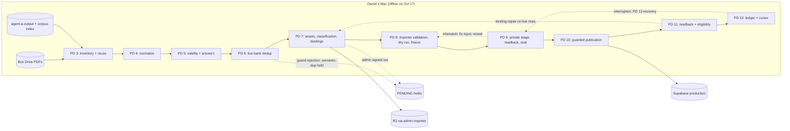

# Released-exam import: current-state analysis

Date: 2026-10-17. Audience: the owner (Zakaria) and the Claude Code agents continuing the import.
Companion to `docs/ingestion/released-exam-import-optimized-workflow.md` (doc A, the revised
workflow). This document records the evidence that doc A's decisions rest on. Nothing in this
analysis changed code, schema, Box files or production data.

**Baseline.** `docs/ingestion/question-import-process-2026-10-17.md`, cited below as **PD §N**
(section) or **PD:N** (line). It is byte-identical to the process doc uploaded on Oct 17.

**Labels.** **M** = measured (a recorded count, timestamp or listing). **D** = derived arithmetic
from M values, with the derivation shown. **E** = estimate (from code comments, docs or judgment).
**[MEASURE]** = unknown until measured. **CIC** = "confirm in checkout": the fact lives in the
`karman-release` checkout on the owner's Mac, which is offline and is not on GitHub main. No
karman-release CLI flag, field name or schema is stated here unless the PD states it.

**Vocabulary** follows the PD unchanged: source occurrence, selected inventory, published catalog,
checked / privately loaded / published, LIVE, CERTIFIED_DUPLICATE, BROKEN, PENDING, frozen manifest,
private stage, seal, guarded publication, readback, ledger, cursor.

---

## 1. Scope and evidence base

### 1.1 What was inspected

| Source | What was read | How | Notes |
|---|---|---|---|
| GitHub main, HEAD `fade5fe` (2026-06-12) | Pipeline scripts, import core, publish gate, migrations, renderer, grader, ADRs, CI workflows, `docs/ingestion/*` | 16 read-only investigator passes plus spot checks of cited lines | Shallow clone (53 commits visible). The PD was added on top in commit `6d6bb79` (2026-10-17). The newest migration is `20260531000000_phase9a_figure_columns.sql` |
| Box `SAT_Digital/Released_Exams` (folder 253176710381) and every subfolder | id, name, size, sha1, modified | Folder listings only. No file was downloaded | §5 |
| Process doc | All 17 sections and the evidence list | Full read | The only description of the Oct 2026 production path |
| Oct 16 operational history | Timestamps and counts quoted in the PD | Via PD:17-22, 77, 343, 365, 440-449 | Not re-measured |

### 1.2 What could not be inspected

| Not inspected | Why | Effect on this analysis |
|---|---|---|
| `karman-release` on the owner's Mac: `scripts/pdf-pipeline/import-reviewed-questions.ts`, `src/lib/question-bank/catalog-question-scope.ts`, the gate as used, seal and binding code, ledgers, manifests, cursor, private snapshots | Mac offline. None of these files exist on GitHub main (`ls` fails; no git history) | Every statement about the production importer, gate or catalog scope comes from the PD and is CIC |
| `agent-a-output` captures, `corpus-index.json`, A/B/C/D/CF packages (PD:34-35, 85) | On the Mac only | Snippet counts, capture units and the A-G agent contracts are unverified |
| Production Supabase | No DB access in this task | No current counts, distributions, view definitions or migrations applied after `20260531000000` |
| Deployed Worker revision | Not inspected | Renderer and grader support in production (for example `<u>`, numeric sets) is CIC |
| Provider tiers and quotas | Not visible in the repo | Rate limits in code comments are E and conflict (§4.5) |

### 1.3 How to read the rest of this document

- GitHub main is about four months older than the Oct 16 production state (PD:17 vs. `fade5fe`).
  Main describes building blocks, not the production path.
- Every count after Oct 16 ~10:26 is unknown. The interrupted US V2 RW M2 Q11 operation has no
  readback (PD:18).
- Where main and the PD disagree, the PD describes production and main describes risk (§6).

---

## 2. Current-state value stream map

The PD path (PD:11) as it ran on Oct 16. One recorded publication task carried the work
(PD:440). Parallel reviewers are recommended (PD §15) but are not evidenced in the history, so
this map shows one agent doing every step (inference).



### 2.1 Steps

| # | Step (PD §) | Actor | Location | Waits and handoffs | Rework loop | Evidence |
|---|---|---|---|---|---|---|
| 1 | Resume and inspect (§13 steps 1-5) | agent | Mac | Waits for a working session after usage limits | Recovery branches (PD:354-358) | Episode A: 14 published in 132 min (D, §4.2) |
| 2 | Pick the next slice (§13.6) | agent | Mac | Single cursor | n/a | Historical cursor parked on the `2025-10_US_V1_MATH_M1_Q06` asset hold (PD:22, 360) |
| 3 | Inventory and reuse (§3) | agent | Box Drive, agent-a-output | Join by stable ID and hashes | Re-extract only changed or defective packages (PD:93) | Time [MEASURE] |
| 4 | Normalize (§4) | agent | Mac | none recorded | Any change invalidates downstream hashes (PD:136) | Time [MEASURE] |
| 5 | Validity and answer review (§5) | agent | Mac | Solver calls | Printed-key conflicts: corrected when an independent solve is defensible, held only if the source stays ambiguous (PD:153, 162) | Time [MEASURE] |
| 6 | Live-bank dedup (§6) | agent | Mac + Supabase read | Fresh production preflight (PD:172) | Stem-guard rejection becomes a semantic-duplicate hold (PD:189) | Duplicates found only after steps 4-5 (W1) |
| 7 | Assets, classification, bindings (§7) | agent + owner session | Admin importer, R2 | Signed-in admin session (PD:207) | Envelope or binding gaps found later (PD:211) | 53 reviewed SVG rows waited (historical, PD:197) |
| 8 | Validate and freeze (§8) | agent | karman-release | none recorded | Edits after freeze force recomputation (PD:232) | Checkpoint deltas +19, +11, +6, +10 (D, PD:407-408, 415; release size not recorded) |
| 9 | Private stage, readback, seal (§9) | writer | Supabase | none recorded | Defaults or serialization differ from preview (PD:265) | figure_kind fix 08:22-08:33, up to 11 min (D from approximate PD timestamps, upper bound; PD:444) |
| 10 | Guarded publication (§10) | writer | Supabase | none recorded | Guard failure: re-read and trace (PD:277) | none recorded |
| 11 | Production readback and eligibility (§11) | writer | Supabase + app checks | none recorded | Binding-hash repairs on already-published rows | 12 rows repaired 08:51-09:39, up to 48 min (D, upper bound: PD:446 records other work at 09:34-09:39 inside the window; PD:445) |
| 12 | Ledger and cursor (§12) | writer, manual | Mac files | none | Interruption between publish and ledger | Session died ~10:32 before Q11 readback (M, PD:18, 449) |

### 2.2 Handoffs between locations

| From | To | What crosses | Failure observed or latent |
|---|---|---|---|
| Box (Mac Box Drive) | agent workspace | PDFs by filename | Same basename with different bytes in different folders (§5.3). No revision key stored in the repo or `pdf_processing_jobs` |
| agent-a-output (2026-10-05 task) | 2026-10-11 task workspace | captures, packages | `202408usv2.pdf` was modified in Box on 2026-10-10, after the capture date (M, Box listing); re-extraction status unknown |
| karman-release | GitHub main | nothing | The importer, gate, scope and ledgers never reached GitHub (§6) |
| agent | owner | admin session for asset upload | Session signed out; assets held (PD:207) |
| agent | next agent session | ledger, cursor, manifests | Q11 left with a publication claim and no readback (PD:18) |

### 2.3 Waits

- **Usage limits and executor interruptions.** Episode A lost up to about 107-115 min (D, upper bound, §4.2). The
  ~10:32 usage limit stopped the session mid-operation (PD:18).
- **Authentication.** Asset work waits for a signed-in Clerk admin session (PD:207).
- **Mac availability.** Every write, and every step that needs captures or ledgers, depends on one
  machine (PD:30-36).

### 2.4 Rework loops

| Loop | Trigger | Recorded cost | Where it is caught today |
|---|---|---|---|
| R1 Private-stage mismatch | Omitted figure became `figure_kind='image'` (PD:134) | up to 11 min (D, upper bound) | Private-stage readback |
| R2 Post-publish binding repair | Answer records lacked the two version-binding hashes the skill pool needs (PD:211) | up to 48 min, 12 live rows (D, upper bound; PD:446) | Row-level eligibility after publication |
| R3 Missing classification envelope | Envelope absent (PD:211, 265) | not recorded | Private-stage guard |
| R4 Guard rejection | Importer stem guard rejects a one-changed-distractor item, recorded as a semantic-duplicate hold (PD:189; status OD-6) | not recorded | At import, after review was spent |
| R5 Interruption recovery | Lost executor between steps (PD:267, 363) | Episode A up to ~107-115 min (D, upper bound) | Next session, by hand |
| R6 Hash invalidation | Content edit after review (PD:136, 232) | not recorded | Freeze or seal |

### 2.5 Single writer

- The PD requires exactly one production writer; parallel workers may only prepare and review
  (PD:275, 388-389).
- The writer runs §9-§12 serially for each release (checkpoint deltas of 6-19 questions; release
  size not recorded, [MEASURE]). Its rate bounds throughput: 29-33 q/h observed, up to 43-49 q/h
  rework-free (D, upper bound, §4.2).
- No lease or lock artifact is described in the PD or exists on main; whether karman-release has
  one is CIC. The 2,525 vs. 2,707 episode shows the cost of guessing about
  other writers: a concurrent-writer inference was made and later withdrawn (PD:77).
- On GitHub main nothing enforces one writer: `process-pdf.yml` has no `concurrency:` key, and
  the orchestrator, admin import and cron paths can all insert rows (publication findings). This is
  one more reason not to publish these items through main (§6).

---

## 3. Waste analysis

Lean waste types (TIMWOODS). Costs are labeled. "Doc A" names the stage or decision that removes
the waste.

| ID | Lean type | Waste | Evidence | Estimated cost | Doc A remedy |
|---|---|---|---|---|---|
| W1 | Over-processing | Duplicates are normalized and answer-reviewed before dedup (PD:11 order) | Duplicates at the latest per-exam checkpoints: US V1 4.1%, Asia V1 10.2% (D, PD:365). On main, dedup is per-PDF exact at most (`supabase/migrations/20260514002443_question_ingestion.sql:62-64`), and it never fires on the orchestrator path because `content_hash` is null there (§6.1) | Each 100 duplicate occurrences reviewed costs about 10-42 agent-hours at 6-25 min per item (E) | S4 corpus clustering; canonical-only review |
| W2 | Defects | Known failure classes are caught at private stage or after publication | R1-R3 in §2.4 | Up to 59 of 180 min (07:26-10:26), about 33% of the writer window (D, upper bound) | PF01-PF04 preflight lint; stored-vs-manifest diff |
| W3 | Waiting | Interruptions and usage limits | Episode A (PD:442); death at ~10:32 (PD:18) | About 107-115 min in Episode A (D, upper bound); one operation of unknown state | Intent records; idempotent reconcile; S0 |
| W4 | Transportation (handoffs) | Four disjoint locations: Box, agent-a-output, karman-release, GitHub main | PD:30-36; §6 | All writes blocked while the Mac is offline (true on Oct 17); hours [MEASURE] | Push karman-release to a GitHub branch (doc A P1) |
| W5 | Inventory | Holds hide ready work behind a single cursor | Holds 37.8% (US V1) and 24.5% (Asia V1) at the latest per-exam checkpoints (D, PD:365); 3,378 PENDING at 09:57 (M, PD:343); 53 SVG rows queued (PD:197) | Holds cost 24.5-37.8 points of checkpoint yield vs. BROKEN 0.35% (0.83% of resolved) (D) | Typed PENDING reasons; hold campaigns; cursor keeps holds separately |
| W6 | Over-processing | Whole-PDF re-extraction and repeated page renders (main pipeline) | Kimi call 10-20 min per PDF (E, `scripts/pdf-pipeline/extract-with-gemini.mjs:251`); figures, answer key and crops each re-render pages | About $0.14 and 10-20 min per avoidable PDF re-extraction (E) | Reuse before re-extract; module-level jobs |
| W7 | Motion (manual work) | Readback, ledger and cursor done by hand; small releases | Checkpoint deltas of 6-19 (D; release size not recorded, [MEASURE]); PD §12 procedure | Fixed per-batch overhead 10-15 min (E) is 0.5-2.5 min per question if batches are 6-19 (D from E) | Module-sized batches; one idempotent reconcile |
| W8 | Defects | Silent defaults mask missing data | Difficulty defaults to 4 (`src/lib/question-bank/import-core.ts:159,170`; `src/lib/question-bank/csv-parser.ts:109`) while the DB default is 1 (`supabase/migrations/20260514002428_difficulty_numeric.sql:43`); `figure_kind` DEFAULT 'image' (`supabase/migrations/20260518140651_quiz_questions_figure_native.sql:27-29`) never written by the importer (`import-core.ts:365-402`); slug gate a no-op (`scripts/pdf-pipeline/publish-gate.mjs:105-113`) | Label noise [MEASURE]; up to 11 min for the one figure case on Oct 16 (D, upper bound) | PF01, PF04, PF05 |
| W9 | Defects (measurement) | Flow cannot be measured | No step timestamps; v2 stages carry zero progress weight (`scripts/lib/job-status.mjs:54-61`); every rate in §4 comes from narrative timestamps | Planning error [MEASURE] | Step timestamps in manifests; metrics annex |
| W10 | Inventory | Supply outside the registry and revision ambiguity | 18 subfolder-only forms, 14 separate key artifacts (15 if `202408asiav2-Answers_ReadingONLY.pdf` is a key rather than an exam file), 3 sha1s for `202410usv1.pdf` (§5) | Occurrences outside the selection [MEASURE]; risk of mixing revisions (PD:92) | S1 source registry pinned by sha1 |
| W11 | Over-processing / rework | Evidence keyed to versions, not content (main) | Re-verification keyed on a version string (`scripts/question-audit/verify-answers.mjs:132-137`); escalation prompts show the stored key (`scripts/lib/grader-prompts.mjs:164-193`) | Stale or anchored verdicts [MEASURE] | Content-bound evidence chain; blind arbiter |
| W12 | Over-processing | Many LLM passes per item on main | Answer derived 4-6 times per question; up to 5 vision calls per figure (answers, cleaning-figures findings) | $0.107-0.122 per processed question (D from E, §4.5) | Main pipeline not used for these items; only its pure logic is reused |
| W13 | Non-utilized capacity | One agent runs every step (inference from PD:440) | PD §15 recommends parallel slices; no parallel review recorded | Reviewer capacity, not the writer, is the likely binding constraint (E, doc A §14.1) | Parallel reviewers on non-overlapping slices; one writer |

---

## 4. Measured and derived throughput and rework

### 4.1 Oct 16 timeline (all times UTC, M from PD:17-18, 77, 343, 442-449)

| Time | Event |
|---|---|
| 04:56-07:08 | 14 US V4 Math M1 questions pass frozen checks, stay private across an interruption, then are sealed and published (PD:442) |
| ~07:26 | Reconciliation: 2,525 published catalog vs. 2,707 raw `is_live` rows; 182 older non-ready rows (PD:77, 443) |
| 08:22-08:33 | Omitted figure produces `figure_kind='image'` in private staging; corrected and resealed (PD:444) |
| 08:51-09:39 | Missing version-binding evidence found; 8 October and 4 November Asia V3 rows repaired and re-verified (PD:445) |
| ~09:39 | Asia V1 source report: 64 LIVE, 10 duplicates, 13 awaiting evidence, 11 held (PD:365) |
| ~09:57 | Selected inventory: 2,374 LIVE, 22 CERTIFIED_DUPLICATE, 20 BROKEN, 3,378 PENDING = 5,794 (PD:343) |
| ~10:08 | Aggregate duplicates reported as 32 after 10 Asia decisions (PD:343, 447) |
| ~10:26 | Verified checkpoint: 2,624 published catalog; 36 focused tests pass (PD:17, 448) |
| ~10:30 | US V1 reconciliation: 57 LIVE, 4 certified repeats, 7 Math asset holds, 30 other holds of 98 (PD:365) |
| ~10:32 | Usage limit ends the session after a publication claim for US V2 RW M2 Q11, with no readback (PD:18, 449) |

### 4.2 Derivations

| Quantity | Derivation | Result | Label |
|---|---|---|---|
| Episode A rate | 14 q / (07:08 − 04:56 = 132 min) × 60 | 6.4 q/h (9.4 min/q), interruption included | D |
| Episode B rate | (2,624 − 2,525) / 180 min × 60 = 99 / 3 h | 33.0 q/h | D |
| Episode B, new rows only | (99 − 12 repaired rows) / 3 h, if the 12 repaired rows are inside the +99 delta | 29.0 q/h | D |
| Blended lower bound | ≥ (14 + 87 to 99) / (10:26 − 04:56 = 330 min) × 60 | ≥ 18.4-20.5 q/h (18.4 if the 12 repaired rows are inside the +99 delta) | D |
| Rework share | (11 + 48) / 180 min | 32.8%, about 33% (upper bound; the windows may overlap other work, e.g. the 09:34-09:39 numeric binding, PD:446) | D |
| Rework-free rate | (87 to 99) / (180 − 59 = 121 min) × 60 | 43-49 q/h (43 if the 12 repaired rows are inside the +99 delta, 49 if not; which case applies is [MEASURE]). Upper bound: assumes all 59 min were rework; with the 5 min of PD:446 excluded, 41-47 q/h | D |
| Release cycle | 6-19 q at 29-33 q/h | about 11-39 min per checkpoint delta | D |
| Episode A interruption loss | 132 − 14 × 60 / r, for r = 33 (Episode B incl. the repaired rows) to 49 q/h (rework-free) | about 107-115 min (upper bound; 103 at r = 29) | D |
| Checkpoint deltas | 2,578→2,597 (count/ID reconciliation span, PD:415), →2,608→2,614→2,624 (continuation checkpoints, PD:407-408) | +19 (may span several releases), +11, +6, +10. The +53 from 2,525 (07:26) to 2,578 has no recorded checkpoint; release size is [MEASURE] | D |

Caveats: the 07:26 count may have used a different scope than 2,624 (PD:79 warns about scope);
the checkpoint timestamps for 2,578-2,614 are not recorded; the catalog count when the Oct
workflow started is unknown. All are [MEASURE].

### 4.3 Latest per-exam source checkpoints (D from PD:365)

These are historical source checkpoints reached after several release slices for each exam (PD:365,
410-414), not first-pass yields.

| Exam (98 occurrences each) | LIVE | Duplicate | Held | Of which asset/evidence holds |
|---|---|---|---|---|
| Oct 2025 US V1 (~10:30) | 57 (58.2%) | 4 (4.1%) | 37 (37.8%) | 7 Math asset holds + 30 other holds |
| Oct 2025 Asia V1 (~09:39) | 64 (65.3%) | 10 (10.2%) | 24 (24.5%) | 13 awaiting evidence + 11 held |

Neither report lists a BROKEN item. Holds, not defects, are the main loss at these checkpoints.

### 4.4 Inventory resolution (D from PD:343)

- Resolved at 09:57: (2,374 + 22 + 20) / 5,794 = 41.7%.
- BROKEN rate: 20 / 5,794 = 0.35% of all inventoried occurrences; 20 / 2,416 = 0.83% of resolved
  occurrences (D).
- The 2,624 published catalog and the 2,374 inventory LIVE are different scopes; the catalog also
  counts questions outside the selected inventory (PD:59). They must not be compared or summed.
- Average occurrences per selected exam: 5,794 / 62 = 93.5, against 98 for a full form
  (`scripts/lib/extraction-coverage.mjs:44-48`). Consistent with some partial forms in the
  selection (D; not verified).

### 4.5 The automated pipeline on main (context only; not used for these items)

| Item | Value | Label | Source |
|---|---|---|---|
| Stage 1 Kimi extraction | 10-20 min/PDF, about $0.14/PDF | E | `extract-with-gemini.mjs:29-35, 251` |
| Stages 1-5 before Kimi | 38 min to reach Stage 6 on run #26553926910 | M | commit `2ce378a`; `orchestrate.mjs:152-155` |
| Whole orchestrator per PDF | about 81-120 min | D from E | followup-1 (serial call counts × 3-4.6 s) |
| Cost per processed question | $0.107-0.122 ($10.49-11.98 per 98-question PDF) | D from E | Per-stage cost comments scaled to 98 q |
| Cost driver | Explanations (about $2 per 30 q) and audits (about $0.90 per 30 q) | E | `docs/ingestion/pipeline-v2-redesign-plan.md`; commit `ff0d595` |
| Concurrency | Every LLM stage awaits one row at a time; stages run serially | code fact | `orchestrate.mjs`; `verify-answers.mjs:623` |
| 429 handling | Any HTTP 429 becomes `QuotaExhaustedError`; several stages stop with partial output | code fact | `scripts/lib/llm-providers.mjs:63-69` (class), `:155, 249, 461, 628, 716, 784, 861, 971, 1069` (429 mapping); `extract-figures.mjs:248-250` |
| Gemini free-tier claims | 2.5 Flash 1,500 RPD; 2.5 Pro 25 RPD (another file says Flash 20 RPD) | E, unverified | `scripts/question-audit/llm-grader.mjs:14-22`; `scripts/pdf-pipeline/pull-pdf-job.mjs:429-437` |

The per-PDF figures in the repo conflict: ADR 0004 says ~$2.25/PDF and ~3 min wall time
(`docs/adr/0004-gemini-local-pdf-pipeline.md:40-41`); `process-pdf.yml:30-32` says ~$2.30/PDF and
5-10 min of Actions runtime; `docs/ingestion/pipeline-full-context-for-collaboration.md:71` says
$2.30-2.50. All differ from the D figures above, and none is a measured aggregate.

### 4.6 Completion arithmetic (D)

- Remaining to 10,000 published: 10,000 − 2,624 = 7,376 (7,375 if Q11 verifies).
- Writer-hours for 7,376 at the observed rates: 224 h (33 q/h), 254 h (29), 360-401 h
  (20.5-18.4), 1,159 h (6.36, unrounded Episode A rate).
- The deploy target is November 2026 (`CLAUDE.md`). From Oct 17 (a Saturday) that is 15 days to
  Nov 1 and 44 days to Nov 30 (calendar days; on weekdays only: 10 and 31).
- At 8 writer-hours per day and 33 q/h, 7,376 would take 28 writer-days, if supply existed. §9
  shows that supply is the tighter limit.

### 4.7 Measurement gaps

- No per-step timing is described in the PD or exists on main; whether karman-release manifests
  carry step timestamps is CIC.
- No LLM spend was recorded for the Oct workflow.
- The usage-limit duty cycle (interruptions per day) is unknown.
- Checked and privately loaded totals are unknown (PD:19).

---

## 5. Source inventory findings (Box)

All counts below are M from Box folder listings (id, name, size, sha1, modified), unless labeled.

### 5.1 Counts

| Item | Count |
|---|---|
| Top-level entries in `Released_Exams` | 150: 147 files + 3 folders (`!Remove_Formatting`, `Archive`, `No_Answers`) |
| Top-level files by type | 140 `.pdf`, 3 `.txt`, 2 `.png`, 2 `.docx` |
| Files in subfolders | 87. `No_Answers` 57; `!Remove_Formatting` (with `Archive`) 27; `Archive` 3 |
| Whole tree | about 234 files |
| Top-level names matching `^(\d{6})(us|asia)v(\d+)\.pdf$` | 80 (plus 1 more with the `aisa` typo) |
| Top-level names outside the grammar | 66 |
| Distinct exam-form identities at top level | about 124, including partials, `202403` forms A-D and the `202605` compilation (D; depends on normalization choices) |
| Exam forms found only in subfolders | 18 (§5.4) |
| Byte-identical pairs at top level | 2: `202510usv1 copy.pdf` = `202510usv1.pdf`; `202512usv1 copy.pdf` = `202512usv1.pdf` |
| Top-level PDFs over 18 MiB | 27. Largest: `202408usv1.pdf` 203,480,530 bytes; `202408usv5.pdf` 153,478,934; `202411asiav2.pdf` 135,585,545 |

Context: the PD's selected inventory is 62 exams and 5,794 occurrences; the raw count is 11,920
occurrences (PD:71-72). The owner's brief says "~11,000 snippets from more than 80 exams". As a
rough cross-check only, 11,920 / 98 = 121.6 full-form equivalents, close to the ~124 top-level
identities (D; not a conclusion about what the 11,920 contains).

### 5.2 Naming anomalies

| Class | Examples | Effect |
|---|---|---|
| Region typo | `202412aisav1-Ver2`, `202412aisav2`, `202412aisav3`, `202412aisav4` | Grammar miss; alias to `asia` in a registry, never rename |
| Hyphenated version | `202405asia-v2`, `202406asia-v1` | Grammar miss |
| Two-digit version | `202509us01` … `202509us06` | Mapping to V1-V6 needs owner confirmation |
| Missing version | `202405us.pdf`, `202406us.pdf` | Exam key incomplete |
| Missing region | `202303-`, `202305-`, `202306-Full`, `202306-v2-Full`, `202310-`, `202311-`, `202312v1-full` | Exam key incomplete |
| Form letters | `202403_March+A` … `+D` | No region or version in the name |
| Compilation | `202605math-105q-Marked_Answers` | Not an exam form; useful as duplicate evidence |
| Revision tags | `-new`, `-Ver2`, `-Ver3`, ` copy`, `-1` (`202406asiav3-1`), `_reformatted` | Same exam key, possibly different content |
| Scope tags | `rw_only`, `-rw`, `-Reading_Writing_only`, `_noMath`/`_NoMath`, `Math_Module2_missing`, `-Full`/`-full`, `-screenshot` | Expected coverage differs from 98 |
| Role tags | `_Answers`/`-Answers`/`-answers`, `_Math_answers`, `_RW_answers`, `-Answers_MathONLY`, `-Answers_ReadingONLY`, `_wAnswers`, `-Marked_Answers`, `_NoAnswers`, `-AnswersExplained_Nabil` | Answer artifacts, not exams; the last is third-party explanations |

The repo documents two filename conventions. The current Stage 1 prompt uses lowercase `YYYYMM` +
`us|asia` + `v<N>` (`question-imports/prompts/stage1-extraction-user.md:6-12`, e.g.
`202406asiav2.pdf`), which matches the 80 grammar-conforming Box names. The superseded KarmanGPT
prompt uses `YYYYMM[Region]V[N].pdf` with uppercase examples and a month list (01, 03, 05, 08, 10,
11) that omits Box months 06, 09 and 12 (`question-imports/chatgpt/KarmanGPT.txt:40-51`). The PD's
occurrence ID `YYYY-MM_REGION_VN_SUBJECT_MN_QNN` (PD:53) is the ledger-level convention.

### 5.3 Revision ambiguity

- Same basename, different bytes across folders: `202410usv1.pdf` has 3 distinct sha1s;
  `202411asiav1` and `202411asiav2` have 3 each; `202408usv1`, `202408usv2`, `202408asiav1`,
  `202412usv1`, `202412usv2`, `202503asiav2`, `202508usv1`-`4` and `202509us01`-`06` have 2 each.
- `202511usv1.pdf` (sha1 `5aa53258…`), `202511usv1 copy.pdf` (`4d750023…`, different bytes) and
  `No_Answers/202511_Exams/202511usv1-new.pdf` (`a155cced…`) are three candidates for one form.
- `202508usv1`-`4` exist as 9-14 MB originals in `No_Answers` and as 46-54 MB reformatted outputs
  with the same filename.
- Neither the repo nor `pdf_processing_jobs` stores a PDF content hash; `source_pdf` is the
  basename only (`scripts/pdf-pipeline/import-json-direct.ts:51-53`; `import-json-direct-row.ts:47`). Box exposes sha1 per file
  in listings, so a revision key is available without downloading.

### 5.4 Forms found only in subfolders (18)

`202408usv4`; `202412aisav2`, `202412aisav4`; `202503asiav4`-`v9` (6); `202503usv1`-`v3` (3, plus
`_reformatted`); `202505usv2_NoAnswers`; `202506usv2`; `202508asiav2-rw-screenshot`;
`202509asiav3`; `202510asiav3`; `202510asiav4`. Whether any are in the 62-exam selection or the
11,920 raw count is unknown (open question Q-C1, OD-12).

### 5.5 Separate answer-key artifacts

- Text, image and document keys: `202408usv1_Answers.txt`, `202411usv1-Answers.txt`,
  `202411usv2_Math_answers.txt`, `202411asiav1-answers.png`, `202411asiav2-answers.png`,
  `202412usv1_answers.docx`, `202412usv2_math_answers.docx`.
- PDF-only keys: `202408usv2_Answers`, `202408usv3_noMath_Answers`, `202411asiav3_Answers`,
  `202411asiav4_Answers`, `202411usv2_RW_answers`, `202412aisav3-Answers`,
  `202408asiav2-Answers_MathONLY`.
- Unclear: `202408asiav2-Answers_ReadingONLY.pdf` (19.4 MB) may hold question pages, not only a key
  (open question in the ingestion findings); not counted in the 14 above.
- Edit history: `202411usv2_Math_answers.txt` etag 13 (modified 2026-02-04);
  `202411usv1-Answers.txt` etag 8 (2026-04-21); `202408usv1_Answers.txt` exists as two different
  798-byte versions.
- No repo script loads them. `extract-answer-key.mjs` reads key pages from the same PDF only and
  pairs keys to questions by position (`scripts/pdf-pipeline/extract-answer-key.mjs:10-19,
  373-427`).

### 5.6 Implications

- A filename is not a safe identity. A registry keyed by Box file id plus sha1, with raw names
  untouched, is needed before supply can be counted (doc A S1).
- The coverage expectation must follow scope (full, RW-only, Math-only, missing module), not a
  fixed 98 (`scripts/lib/extraction-coverage.mjs:37-48` holds the full-form numbers).
- Main's Stage 4 would fail on the 27 PDFs over 18 MiB (`extract-answer-key.mjs:447-449`; "PDF
  too large" is terminal in `scripts/lib/retry-decision.mjs:55`).

---

## 6. Codebase drift: GitHub main vs. karman-release

### 6.1 Capability table

| Capability | GitHub main (`fade5fe`) | karman-release (per PD; CIC) | Risk if main is used for these items |
|---|---|---|---|
| Reviewed importer | Absent. `import-json-direct.ts`, `bulk-import.ts` and `import-core.ts` instead. `import-json-direct.ts` has no dry-run | `import-reviewed-questions.ts` with validation, dry run and export (PD:36, 217) | No dry run; different contract |
| Student visibility | `is_live` = `(import_status IS NULL OR 'ok') AND archived_at IS NULL` (`supabase/migrations/20260528093631_archive_old_pipeline_questions.sql:48-53`); fetch filters `node_id` and `is_live` only (`src/lib/supabase/queries/quiz/questions.ts:51-52`) | `catalog-question-scope.ts` plus row-level eligibility and skill-pool binding checks (PD:38, 79, 211) | A clean row is student-visible at insert. There is no private stage |
| `publish_status` | 11 values, default 'draft' (`supabase/migrations/20260525000000_pdf_ingestion_v2_phase1.sql:27-41`). The view `quiz_questions_live` was switched to `publish_status` (phase1.sql:107-109), then recreated on `is_live` (archive migration:64-65) | Not described; scope is CIC | `blocked_*`, `duplicate_detected`, `corrupt_question` and `rejected` rows stay visible if `is_live` is true |
| Private stage and seal | Absent (no seal, snapshot or payload-hash code) | Present (PD §9) | No staging boundary |
| Binding hashes, classification envelope | Absent (no column, code or migration) | Present (PD:209-213) | Rows would fail the production skill pool |
| Publish gate | `publish-gate.mjs` sets `publish_status` only; never demotes (`publish-gate.mjs:19-22`); slug gate reads the deleted `src/data/curriculum.ts` and is a no-op (`:105-113`); findings errors fail open | Guarded predicates on identity, content, choices, answer evidence and seal (PD:271-273) | Main's gate does not gate students |
| Exact dedup | Unique `(source_pdf, content_hash)` only (`question_ingestion.sql:62-64`), per PDF. The orchestrator path never fills `content_hash` (`import-core.ts:393` passes the extractor value, which the prompt forbids) | Source identity, content hashes and stem guard against the live bank (PD:170-172) | Cross-exam duplicates undetected; re-runs insert duplicate rows |
| `content_hash_v2` | SHA-256 of `trim().toLowerCase()` fields, positional choices, includes domain (`import-core.ts:181-211`); indexed, not unique (`phase1.sql:91-95`); write-only | CIC | Reordered choices or a domain change break the match |
| Near-dup and choice mapping | None. `question-matcher.mjs` matches crops to rows; it is not a dedup tool | Stem guard plus manual full comparison and answer-text mapping (PD:172-181) | Reorder case (PD:185) not automated anywhere |
| `duplicate_detected` | Never written; read only at `scripts/lib/explanation-eligibility.mjs:102-104` | CERTIFIED_DUPLICATE in the ledger (PD:319) | No DB representation of duplicates |
| Duplicate skip | Returns `question_id: null` with no link to the existing row (`import-core.ts:413-420`); any error matching `/duplicate/i` is treated as a skip | CIC | Certification needs a manual search |
| Numeric answer sets | One `correct_answer` within an absolute tolerance (`src/contexts/QuizContext.tsx:295-316`); `answer_key_entries.acceptable_answers` exists (`supabase/migrations/20260526000000_pdf_ingestion_v2_phase2.sql:32`) but the grader never reads it | 2.4 and 4.8 accepted as a two-value set; 7/3 and 2.333 accepted as equivalent forms with near values rejected (PD:155-157) | Two-root items graded wrong |
| Underline `<u>` | `MathText` emits non-math text as escaped React text (`src/components/learn/MathText.tsx:131`) | Supported markup used (PD:105) | Literal tags shown to students |
| Figure representation | `figure_kind` DEFAULT 'image' (`20260518140651_quiz_questions_figure_native.sql:27-29`); the importer never writes it and has no `figure_kind`/`figure_table_data` input (`import-core.ts:60-111, 365-402`) | Explicit no-figure required; native tables released (PD:118-134) | Text-only rows stored as images (the Oct 16 class) |
| Difficulty default | 4 at import (`import-core.ts:159,170`; `csv-parser.ts:109`); DB default 1 | CIC | A defaulted level looks judged |
| Original text | `raw_question_text`/`raw_choice_text` mirror the normalized input (`import-core.ts:371, 451`) | CIC | Correction signal lost |
| Printed key evidence | The import seed copies the imported letter into `printed_answer`, status `printed_key_used_no_correction` (`import-core.ts:464-480`). Stage 4 later inserts separate `answer_key_entries` rows with the printed key, crossed-out and correction signals and the section/module/number locator (`extract-answer-key.mjs:600-628`), but only for in-PDF key pages, PDFs ≤ 18 MiB and equal per-section counts (positional pairing, `:414-421`) | Printed key and verified answer both kept (PD:146, 153) | Discrepancy and locator lost when Stage 4 does not run or does not match |
| Occurrence identity | `quiz_questions` gets `source_pdf` and `source_page` only; section, module and question number reach the DB only through Stage 4 `answer_key_entries` rows (limits above) | Stable occurrence ID in ledgers (PD:53) | No reliable join key to the ledger |
| Ledgers, manifests, cursor | Absent | Present (PD §16) | No reconciliation |
| Asset upload | Two R2 routes. (a) Bulk import: the non-exported `materializeImage` (`src/lib/question-bank/bulk-import.ts:97-127`) is reachable only through `bulkImportRows`, so each upload also inserts a row; image rows are auto-flagged `needs_review` (`:135-151`); 2 MiB cap (`:88`). (b) Per-question upload on an existing row: `actionUploadQuestionImage` (`src/app/admin/actions.ts:186-206`) → `uploadQuestionImage` (`src/lib/supabase/queries/quiz/questions.ts:304-331`), which updates `image_url`/`image_storage_path`/`image_alt` only | Admin importer SVG upload through R2 (PD:41, 197); whether it can upload without inserting is CIC | Route (a) creates duplicate rows; route (b) sets no `figure_kind` and no `source_assets` row |
| Answer verification binding | Keyed on a version string, not content (`verify-answers.mjs:132-137`); escalation prompts include the stored key (`grader-prompts.mjs:164-193`) | Bound to the exact revision (PD:145, 149) | Stale or anchored verdicts |
| Writer concurrency | No `concurrency:` key in `.github/workflows/process-pdf.yml` | One writer (PD:275) | Concurrent inserts |

### 6.2 Visibility in detail

- Two visibility systems exist on main. `publish_status` is maintained by `publish-gate.mjs`;
  student delivery reads `is_live` (generated) plus `node_id`. A row imported with
  `import_status` null and a valid slug is live at insert.
- The Phase 1 design intended `publish_status` (or a catalog scope) to gate students. The archive
  migration of 2026-05-28 reverted the view to `is_live`.
- The PD's 2,525 catalog vs. 2,707 raw `is_live` (PD:77) shows that production applies more than
  raw `is_live`. On main the student-reachable set is `is_live AND node_id IS NOT NULL`, which can
  also be smaller than raw `is_live` (rows imported without a slug get a null `node_id`,
  `import-core.ts:320`). Which predicate the deployed Worker runs is CIC (Q-A3).

### 6.3 Dedup in detail

- Five or more hash formulas circulate on main (JS v1 without passages, Python v1 with passages,
  ChatGPT prompt, routine docs, v2 SHA-256). Rows hashed under an old formula never collide with
  new ones.
- The v1 hash omits passages, so cross-text R&W items with the same generic stem collide (audit
  CRIT-4). v2 fixes this but is not enforced.
- Soft reject deletes the row and cascades away its evidence (`src/lib/supabase/queries/quiz/rejected.ts:104`),
  and import never consults `rejected_questions`. A rejected duplicate can come back.
- No production duplicate rate has ever been measured (the audit only proposed a query).

### 6.4 Other latent defects on main (not on the critical path; doc A OD-19)

Positional answer-key pairing with a random UUID tie-break; a no-op `--force` idempotency guard
in `extract-answer-key.mjs`; SymPy not installed in `grade-only.yml`; Phase 5 multi-repair offset
drift (`x2 + x2 + 1` becomes `x^2 +x^22 + 1`); grader findings never block (hydration reads
`source='auditor'` only); 429 throttles treated as terminal quota; non-atomic import with up to 5
round trips per row.

---

## 7. External services matrix

Constraint 3: no external service that is not already mentioned or approved. "Approval evidence"
means an ADR, `docs/architecture.md` or the PD. DeepSeek, Llama, Groq and OpenRouter are
"mentioned" in the ingestion docs (rows below), but none has an ADR; only Kimi/Moonshot is absent
from `docs/`.

### 7.1 Matrix

| Service | Status | Approval evidence | Wiring evidence | Role today | Use allowed in doc A |
|---|---|---|---|---|---|
| Supabase Postgres | APPROVED + WIRED | `docs/architecture.md:23-25, 187`; PD:41 | CI secrets `process-pdf.yml:68-69` | Production DB | Yes |
| Cloudflare Worker `karmanprep` + R2 (existing binding) | APPROVED + WIRED | `docs/architecture.md:15, 186`; PD:41 | `src/lib/storage/r2.ts`; `bulk-import.ts:97-127` | App runtime; figure assets | Yes, through the existing route |
| Clerk | APPROVED + WIRED | `docs/architecture.md:19-21, 188` | Admin guard on the import action (`src/app/admin/actions.ts:65-71`) | Admin auth for asset upload | Yes |
| GitHub + Actions | APPROVED + WIRED | `CLAUDE.md`; PD:32 | `process-pdf.yml`, `grade-only.yml`, `ci.yml` | Repo, CI | Yes (branch for karman-release) |
| Box | APPROVED (source of truth) | PD:33 | No repo integration | PDFs and key files | Yes, listings and Box Drive reads |
| Google Gemini | APPROVED + WIRED | ADR 0004 (Accepted): Gemini Flash for extraction and figure bbox, 2.5 Pro as fallback (`docs/adr/0004-gemini-local-pdf-pipeline.md:18-24, 35, 46`) | `GEMINI_API_KEY` (`process-pdf.yml:70`) | Figure bbox (Stage 2), answer-key pages (Stage 4), question crops (Stage 5), figure structure (6.5), Phase 5 math-repair vision check and text solver (`repair-math-notation.mjs:213-219, 262-275`), Stage 8 Flash checker, Pro escalation; legacy blind solver in `llm-grader.mjs` | Existing vision and solver roles (doc A uses Gemini as a second-provider solver). Not prose transcription (RECITATION, below) |
| Anthropic Claude | APPROVED + WIRED | ADR 0004:27, 41, 45 (Sonnet for explanations) | `ANTHROPIC_API_KEY` (`process-pdf.yml:71`) | Sonnet for explanations, QA, audits; Opus 4.7 as arbiter and escalation (`scripts/lib/grader-roles.mjs:51, 60`) | Yes. Opus beyond extraction has no ADR (ADR 0004:34 rejected it only for extraction, on cost) |
| Coding agents (Claude Code, Codex) | In use (PD) | PD is addressed to Claude Code; workspace paths contain "Codex" (PD:30, 34) | n/a | The Oct review work | Claude Code sessions (reviewers, writer). Codex (OpenAI) only if the owner confirms; its use is inferred from a workspace path name |
| Moonshot Kimi K2.5 (text) | WIRED, UNDOCUMENTED (no ADR, no doc) | None (commit `f72292b` only) | `EXTRACTION_MODEL` default `kimi-k2.5` (`extract-with-gemini.mjs:205`); `MOONSHOT_API_KEY` (`process-pdf.yml:75`) | Stage 1 default on main | Only where already wired, after owner ratification (OD-3); never expanded |
| Moonshot Kimi K2.5 (vision) | WIRED, UNDOCUMENTED (no ADR, no doc) | None | `extract-with-images.mjs` (not in the orchestrator) | Standalone image path | Same as above |
| DeepSeek V3 via OpenRouter | WIRED, NO ADR (documented in `docs/ingestion/pipeline-v2-redesign-plan.md:302-303` and `docs/ingestion/pipeline-as-of-2026-05-24.md:146`) | None (no ADR) | `scripts/lib/grader-roles.mjs:47, 56`; `OPENROUTER_API_KEY` (`process-pdf.yml:72`) | Stage 8 primary solver; math-repair solver | Never required for quorum |
| Llama 3.3 70B via Groq or OpenRouter | WIRED, NO ADR (documented in the same two docs) | None (no ADR) | `scripts/lib/grader-roles.mjs:48, 57`; `GROQ_API_KEY` (`process-pdf.yml:73`) | Stage 8 independent solver; `grader_runs.provider` says 'groq' even when OpenRouter carries the call | Never required for quorum |
| OpenAI | APPROVED for app use only | `docs/architecture.md:41-42` (recap drafts; recap since moved to DeepSeek in `3f27590`) | `extract-with-images.mjs --provider openai` (gpt-5.5) | Not used for import in the orchestrator | Not for import |
| Resend, Stripe | APPROVED (app) | `docs/architecture.md:27-33, 189-190` | App only | Not part of import | n/a |
| ChatGPT Custom GPT (KarmanGPT) | SUPERSEDED | ADR 0003 superseded 2026-05-21 (`docs/adr/0003-chatgpt-custom-gpt-imports.md:3-5`) | none | Still named as current in `docs/handoff.md:71, 78` | No (its rubric text is reused, §8) |
| Gemini 3.5 Flash as Stage 1 text extractor | SUPERSEDED in practice | ADR 0004 still "Accepted" | `extract-with-gemini.mjs:19-23`: "100% block rate on real SAT content. NOT VIABLE" | none | No |
| Claude-API daemon (`pull-pdf-job.mjs`) | SUPERSEDED | ADR 0004:29 (deprecated) | File kept with a banner | none | No |
| Kimi via OpenRouter (PDF input) | ABANDONED | none | `extract-with-gemini.mjs:24-28`: hallucinated math | none | No |
| Mathpix | MENTIONED, NOT IMPLEMENTED | `question-imports/EXTRACT_README.md:104-109`; deferred in `docs/ingestion/pipeline-v2-redesign-plan.md:284` | No key, no code | none | No |
| Mistral OCR | MENTIONED, NOT IMPLEMENTED | `pipeline-v2-redesign-plan.md:1698` | No key, no code | none | No |
| marker-pdf | MENTIONED, NOT IMPLEMENTED | `EXTRACT_README.md:82-102` (about 3 GB of weights on first run) | Not installed | none | No |
| Poppler `pdftoppm`, sharp, SymPy 1.13.3, KaTeX, pdfplumber, Tesseract (optional), Pillow, Node/TS, Vitest | LOCAL (no external service) | n/a | `process-pdf.yml:94-114`; `package.json`; `scripts/python/sympy-check.py`; `question-imports/stage1_extract.py` | Rendering, crops, equivalence, math validation, text layer, OCR fallback | Yes |

### 7.2 Notes

- Documentation drift: `docs/handoff.md` and `docs/architecture.md` describe the superseded
  ChatGPT flow; the ADR index omits 0004 (`docs/adr/README.md:23-27`); orchestrate labels Stage 1
  "Claude Sonnet 4.6" while Kimi runs.
- Data retention: Moonshot uploads are not deleted ("Moonshot expires them on their own",
  `scripts/lib/llm-providers.mjs:755-756`), so exam PDFs stay on third-party storage.
- Reproducibility: Kimi K2.5 accepts only temperature 1, so the same PDF yields different JSON;
  ADR 0004's "same PDF gives the same JSON" no longer holds.
- Reachability: `api.moonshot.ai` is blocked on the UT Austin network (commit `f72292b`).

---

## 8. Taxonomy and difficulty facts

### 8.1 Difficulty

| Fact | Evidence |
|---|---|
| `quiz_questions.difficulty_level SMALLINT`, `CHECK (difficulty_level BETWEEN 1 AND 7)`, `NOT NULL`, `DEFAULT 1` | `supabase/migrations/20260514002428_difficulty_numeric.sql:15, 39-45` |
| Labels: 1 "Very easy" … 7 "Very hard" | `src/types/quiz.ts:367-375` |
| Legacy enum `foundational/intermediate/advanced/mastery` backfilled to 2/4/5/6 | `difficulty_numeric.sql:26-32` |
| Both columns are written on every import through a lossy mapping | `import-core.ts:373-374` |
| Student responses store only the legacy enum (`difficulty_at_time question_difficulty NOT NULL`) | `supabase/migrations/20260423002209_lesson_quiz.sql:165` |
| Admin Zod accepts 1-7 for edits, but the bulk-import row takes `difficulty` as a free string | `src/app/admin/schemas.ts:32-40, 128` |
| Rubric target first-try success: about 85% for L1-2, 65% for L3-4, 40% for L5-6, 15% for L7 | `question-imports/chatgpt/KarmanGPT.txt:297-301` (§7 starts at :269) |
| The current Stage 1 prompt asks for 1-7 with "If uncertain, choose a reasonable estimate. Do not spend excessive effort on difficulty." | `question-imports/prompts/stage1-extraction-user.md:357-359` |
| No verification, calibration or second rater exists for difficulty on main | categorization findings |

**Defaults are inconsistent (silent-default risk).**

| Path | Missing or unparseable difficulty becomes |
|---|---|
| `parseDifficulty` (all import paths) | 4, with no flag (`import-core.ts:159, 170`) |
| CSV parser | "4" (`csv-parser.ts:109`) |
| Direct DB insert without the column | 1 (`difficulty_numeric.sql:43`) |
| Extraction validator | not checked; `DIFFICULTY_LEVELS` exists (`scripts/lib/taxonomy.generated.mjs:18`) but is unused there |

A defaulted 4 cannot be told apart from a judged 4. How the 2,624 live rows got their levels is
unknown (Q-M2).

### 8.2 Domains, concept slugs and nodes

| Subject | Domain | Slugs = nodes |
|---|---|---|
| Math (40) | `algebra` 6, `advanced_math` 17, `geometry` 8, `data_analysis` 9 | ids `ma-…` (`src/data/curriculum/math.ts`) |
| Reading and Writing (49) | `info_ideas` 15, `craft_structure` 14, `expression_ideas` 6, `conventions` 14 | ids `rw-…` (`src/data/curriculum/reading-writing.ts`) |

- 8 domains, DB CHECK (`question_ingestion.sql:47-57`). 89 concept slugs, DB CHECK marked
  `NOT VALID`, so legacy rows are unchecked (`supabase/migrations/20260518003000_concept_slug_check.sql`).
- One slug per node (89 = 89, counted). `node_id` comes from the slug (`nodeIdFromSlug`,
  `src/lib/question-bank/taxonomy.ts:85-87`). `topic_cluster` comes from the slug's domain when a
  slug is present, otherwise from a caller-supplied `topic_cluster`, otherwise from `domain`
  (`CLUSTER_BY_DOMAIN`, `taxonomy.ts:35`; `import-core.ts:315-319`). `subject` comes from `domain`
  (`:311`). With no slug ↔ domain check, a mismatched slug yields `domain`/`subject` that disagree
  with `topic_cluster`/`node_id`.
- There is no separate "skill" entity in the schema or code. The finest grain is the concept slug
  (node). Whether the owner's "skills" means these 89 is an open decision (OD-1).
- Coverage grid size: 89 × 7 = 623 node-level cells; 10,000 / 623 ≈ 16 per cell and 10,000 / 89
  ≈ 112 per node if spread evenly (D). No node × level report exists.

### 8.3 Validators and thresholds

| Check | Where | Behavior |
|---|---|---|
| Domain and slug validity | `import-core.ts:224-276` (`validateImportRow`) | Unknown domain or slug is a hard error; slug optional |
| Slug ↔ domain consistency | none | `validateImportRow` checks them independently |
| Section ↔ domain | `scripts/lib/extraction-validation.mjs:247-250` (`section_domain_mismatch`) | Flags any item whose domain's subject differs from its section (e.g. R&W evidence items labeled `data_analysis`) |
| Slug alignment (LLM) | `scripts/pdf-pipeline/audit/check-slug-alignment.mjs:138-161` | Escalate to Opus when assigned confidence < 0.7 or the model rejects the slug and suggests another; BLOCKING when it rejects the slug and suggests a different one at ≥ 0.85 |
| Publish-gate slug gate | `publish-gate.mjs:105-113` | No-op: reads the deleted `src/data/curriculum.ts` |
| Taxonomy copies | `scripts/sync-taxonomy.ts`; CI stale check | 6 generated copies are CI-checked; the SQL CHECK list is maintained by hand |

---

## 9. Yield and target feasibility

### 9.1 Units

- Only verified LIVE rows count toward the published catalog. An occurrence is not a unique
  question; revisions, duplicates, holds and repaired metadata never count as new (PD:47-73, 436).
- Remaining need: **7,376** (D: 10,000 − 2,624). It becomes 7,375 if Q11 verifies.

### 9.2 Formula

```
NewLIVE = N_pend · p_live + N_other · u · p_live
p_live  = 1 − p_dup − p_broken − p_hold_final
```

| Input | Value | Label | Source |
|---|---|---|---|
| `N_pend` | 3,378 PENDING in the selected inventory at 09:57 | M (stale) | PD:343. Predates the 10:08 duplicate update and the 10:26 release, so it overstates current PENDING |
| `N_other` | 11,920 − 5,794 = 6,126 raw captures beyond the selected occurrence count, including revisions and re-captures of selected occurrences (PD:72) | D | PD:71-72. Assumes the selection is a subset of the raw count (CIC) |
| `u` | Share of `N_other` that is distinct, non-revision occurrences | [MEASURE] | Registry plus corpus clustering |
| `p_dup` | 4.1-10.2% | D | PD:365 |
| `p_broken` | 0.35-0.83% | D | 20 / 5,794 (whole inventory) to 20 / 2,416 (resolved only). §9.3-9.4 use 0.35%; at 0.83% each cell is about 46 lower at u = 1 (0.0048 × 9,504) |
| Checkpoint `p_live` | 58.2-65.3% | D | PD:365 (latest per-exam checkpoints, §4.3) |
| `p_hold_final` | Checkpoint 24.5-37.8%; final unknown | D / [MEASURE] | PD:365 |

### 9.3 Projection at checkpoint yields (u = 1; equals doc A scope B; upper bound only in u)

- From pending: 3,378 × 0.582 = 1,966 to 3,378 × 0.653 = 2,206.
- From the rest: 6,126 × 0.582 = 3,565 to 6,126 × 0.653 = 4,000.
- Total: **5,531-6,206 new LIVE** vs. 7,376 needed. Gap 1,170-1,845 at these yields (D); §9.4 shows
  it closes at u = 1 once final holds fall to about 10%.

### 9.4 Sensitivity (D; new LIVE for given `u` and final hold rate)

`p_live` per column: checkpoint 0.582-0.653; holds 10% → 0.7945-0.8555; holds 0% → 0.8945-0.9555
(= 1 − p_dup − p_broken − hold).

| u | Checkpoint holds | Final holds 10% | All holds cleared | Meets 7,376? |
|---|---|---|---|---|
| 1.0 | 5,531-6,206 | 7,551-8,131 | 8,501-9,081 | Yes once final holds are about 10% or lower |
| 0.9 | 5,175-5,806 | 7,064-7,607 | 7,953-8,496 | At 10% holds only with the low duplicate rate; yes with holds cleared |
| 0.7 | 4,462-5,006 | 6,091-6,558 | 6,857-7,325 | No |
| 0.5 | 3,749-4,206 | 5,117-5,510 | 5,761-6,154 | No |

Break-even `u` (D):
- All holds cleared: u ≥ 0.71-0.79, i.e. at least about 4,340-4,870 distinct new occurrences in
  `N_other`.
- Final holds 10%: u ≥ 0.86-0.96.

Marginal effects (D arithmetic):
- Each 10-point cut in the final hold rate adds about 338 + 613·u new LIVE.
- Each 10-point rise in the duplicate share of `N_other` removes about 613·u. US and Asia forms
  of one administration share items, so the duplicate share probably rises in later forms (E,
  direction only).

### 9.5 Time to the checkpoint-yield projection (D)

| Writer rate | Hours for 5,531-6,206 |
|---|---|
| 18.4-20.5 q/h (blended, observed) | 270-337 |
| 33 q/h (Episode B) | 168-188 |
| 45 q/h (rework-free anchor, upper bound) | 123-138 |
| 60-100 q/h (hypothesis, E) | 55-103 |

At 8 writer-hours per day the projection takes about 15-17 days at 45 q/h, 21-24 days at 33 q/h
and 34-42 days at 18.4-20.5 q/h. No rate meets Nov 1 (15 calendar days). All meet Nov 30 if the
writer works every calendar day (44 days); on weekdays only (31), the blended rate does not. The
writer rate is therefore not the binding constraint for November; reviewer capacity and supply are.

### 9.6 Conclusion

- 10,000 from released exams alone is **not assured** and is likely unreachable unless holds are
  nearly cleared and `u` is high (D).
- The levers, in order: hold clearance (assets, evidence, keys), full registry coverage
  (subfolder-only and unselected forms, by owner decision), wrong-key correction instead of BROKEN,
  and variant retention.
- Any gap left after hold clearance can only come from more sources or ML-generated items.
  Generated items must carry a separate origin, be reported apart from released items (OD-11), and
  pass the same duplicate detection (S4 keys and near-duplicate search) against every released
  occurrence, the live bank and each other before staging (doc A §15).
- `u` should be measured during corpus clustering, before more review effort is spent (doc A S4).

---

## 10. ML-readiness capture gaps

The goal: record at import what a later question generator needs, without new migrations. Where
an existing DB column fits, whether the karman-release importer writes it is CIC. Otherwise the
record lives in the ledger or evidence JSON. A new column (for example an origin or occurrence
column) is an owner decision outside this workflow.

| # | What to record | Why the generator needs it | Existing storage (shared DB) | Status on main's import path | Capture route without a migration |
|---|---|---|---|---|---|
| 1 | Occurrence identity: occurrence ID, form, section, module, printed number, page | Join outcomes to sources; family labels | `answer_key_entries.section/module/source_question_number` (`phase2.sql:23-25`); `source_assets.raw_metadata` | Seed leaves the locator null (`import-core.ts:462-470`); `quiz_questions` gets only `source_pdf`, `source_page`; Stage 4 `answer_key_entries` rows carry section/module/number (`extract-answer-key.mjs:600-628`) only for in-PDF keys ≤ 18 MiB with equal per-section counts | Ledger/evidence JSON (system of record); DB locator if the KR importer writes it (CIC) |
| 2 | Source evidence and revision: Box file id + sha1, capture hash, bbox, extraction model and prompt version | Provenance; avoid training on mixed revisions | `source_assets` rows and `raw_metadata`; `figure_extraction_model` | No PDF hash stored anywhere; no model or prompt stamp | Registry plus evidence JSON |
| 3 | Original vs. normalized content, with each correction `{field, original, corrected, reason, capture ref, reviewer}` | "Edits as a training signal" | `raw_question_text`, `raw_choice_text` (`supabase/migrations/20260527022649_pdf_ingestion_v2_phase5.sql:42-43, 78-79`); `question_history` | `raw_*` mirror the normalized text (`import-core.ts:371, 451`) | Correction records in evidence JSON; `raw_*` only if the KR importer passes originals (CIC) |
| 4 | Answer provenance: printed key as printed, solves (role, model), chosen answer text/letter, lane, `answer_source` | Trust label; key-error signal | `answer_source` CHECK `extracted|inferred|hand_corrected` (`question_ingestion.sql:28-30`); `answer_key_entries`; `grader_runs` | `answer_source` written null unless supplied (`import-core.ts:390`); the seed copies the imported letter into `printed_answer` (`:464-469`); Stage 4 rows keep the printed key and corrections where it runs | Evidence JSON (L4) |
| 5 | Numeric accepted set | Correct grading; equivalent-form learning | `answer_key_entries.acceptable_answers` (`phase2.sql:32`) | Not written; grader ignores it | Evidence JSON; DB only where set support is confirmed (CIC) |
| 6 | Classification provenance: slug, derived domain/node, difficulty 1-7, both rater values, rubric version, confidence, "defaulted" flag | Conditioning labels; recalibration | `concept_slug`, `domain`, `node_id`, `difficulty_level` | Level may be a silent 4 (§8.1); no provenance | Evidence JSON (L5) |
| 7 | Features the raters already produce: steps, setup complexity, passage length and vocabulary tier, inference span, expected solving time | Difficulty model inputs (roadmap) | none | Not captured | Evidence JSON. Never `explanation_v2`, which Phase 7 overwrites (`scripts/pdf-pipeline/fill-explanations-v2.mjs:159`) |
| 8 | Distractor category per wrong choice | Distractor generation | `INTERNAL_CATEGORIES` enum (`scripts/lib/explanation-categories.mjs:75-87`) inside `explanation_v2` | Only post-import, optional, overwritten | Evidence JSON when the solver emits it |
| 9 | Dedup and variant family: role, relation, choice mapping, canonical live ID, `NORMALIZER_VERSION` | Families for variant generation; avoid train/test leakage | `content_hash_v2`; `publish_status='duplicate_detected'` (never written) | Duplicate skip returns null id (`import-core.ts:413-420`) | Cluster file plus ledger |
| 10 | BROKEN and held items as negative examples: snapshot, defect, evidence, attempts | Negative training data | `rejected_questions` | `softRejectQuestion` deletes the row and cascades evidence (`rejected.ts:104`) | Snapshot in evidence JSON; never soft-reject |
| 11 | Explicit figure representation: none / native table / asset, with kind | Conditioning on figure type | `figure_kind`, `figure_table_data` | Default 'image' lands on text-only rows | Explicit null in importer input (PF01) and in evidence |
| 12 | Release events: manifest id, staged/published times, reviewer, gate outcome | Approval labels; status history | `question_history`; manifests | Gate decisions printed, not stored (`publish-gate.mjs:232`) | Manifest step timestamps and intent log |
| 13 | Origin marker: `released_official` vs. generated | Keep released and generated apart | none | Inferable only from `source_pdf` plus `answer_source` | `origin` field in ledger and evidence JSON |

Two telemetry limits affect later recalibration. Responses keep only the legacy 4-level enum
(`lesson_quiz.sql:165`), so the 1-7 level at answer time must be reconstructed from
`question_history`. Per-item statistics need a stable `question_id` and choice order after import;
no shuffle exists in `src` today.

---

## 11. Open questions for the owner

IDs in brackets refer to doc A's owner decisions (OD-n) where one exists.

**A. Access and current state**
- Q-A1. When will the Mac and `karman-release` be reachable, and may that work be pushed to a branch
  of the existing repo, with which ledgers and evidence excluded? [OD-16, OD-20]
- Q-A2. What happened to US V2 RW M2 Q11, and what is today's verified catalog count?
- Q-A3. Which visibility predicate does the deployed Worker run: `is_live`, `publish_status`, or
  `catalog-question-scope.ts`? Were migrations applied after `20260531000000`?
- Q-A4. Where are the two answer-record binding hashes and the classification envelope stored,
  and which inputs feed them? Do they cover slug and difficulty?
- Q-A5. Does the production renderer support `<u>` and does the grader accept numeric answer sets?
  Do older live rows contain `<u>` that renders literally?
- Q-A6. Does `import-reviewed-questions.ts` call `import-core.importQuestion`? If so, the main
  defects in §6.1 (figure default, difficulty 4, raw-text mirror, printed-key overwrite) may also
  affect the 2,624 live rows.

**B. Policy**
- Q-B1. Are "skills" the 89 concept slugs (nodes)? [OD-1]
- Q-B2. May an item with no printed key go LIVE on agreeing blind solves (`answer_source='inferred'`)? [OD-2]
- Q-B3. Is a one-changed-distractor item a CERTIFIED_DUPLICATE or a variant? [OD-6]
- Q-B4. What is the operational definition of "Total possible questions"? [OD-15]
- Q-B5. If released supply falls short of 10,000: accept a released-only total, add sources, or
  add ML-generated items under a separate origin? [OD-11]
- Q-B6. Are explanations required before LIVE? [OD-18]

**C. Sources**
- Q-C1. Are the 18 subfolder-only forms in the 62-exam selection or the 11,920 raw count? Should
  unselected forms join the selection? [OD-12]
- Q-C2. Which revision is canonical where several sha1s exist (for example the three `202511usv1`
  candidates)? [OD-5]
- Q-C3. How should `202403_March+A..D`, `202509us01..06`, `202605math-105q` and the names without
  region or version be keyed? [OD-4]
- Q-C4. Was `202408usv2.pdf` (modified 2026-10-10) re-extracted after the change?
- Q-C5. Which engine produced the agent-a-output snippets, and does `corpus-index.json` key by raw
  filename or by exam key and sha1?
- Q-C6. Is `202406us-AnswersExplained_Nabil.pdf` usable (authorship, licensing)?

**D. Services**
- Q-D1. Ratify via ADR, or exclude, Kimi K2.5 (Moonshot), DeepSeek, Llama, OpenRouter and Groq? [OD-3]
- Q-D2. Ratify Claude Opus for arbitration and escalation (it has no ADR for these roles)? Doc A
  uses Opus as wired, since the vendor is approved (doc A §0).
- Q-D3. Are the Gemini, Anthropic and Moonshot keys free-tier or paid, with which limits?

**E. Data and ML**
- Q-E1. Who assigned difficulty for the 2,624 live rows, with which rubric? What is the current
  level distribution and node × level coverage?
- Q-E2. Do the A-G outputs keep raw OCR text apart from normalized text, so original-vs-normalized
  pairs can be backfilled for live rows?
- Q-E3. Are CERTIFIED_DUPLICATE and BROKEN outcomes stored anywhere besides local ledgers?
- Q-E4. Which identity should agent edits use in `question_history.edited_by` (a Clerk user id
  today)?
- Q-E5. What daily agent budget and reviewer pool size are available? [OD-17]
