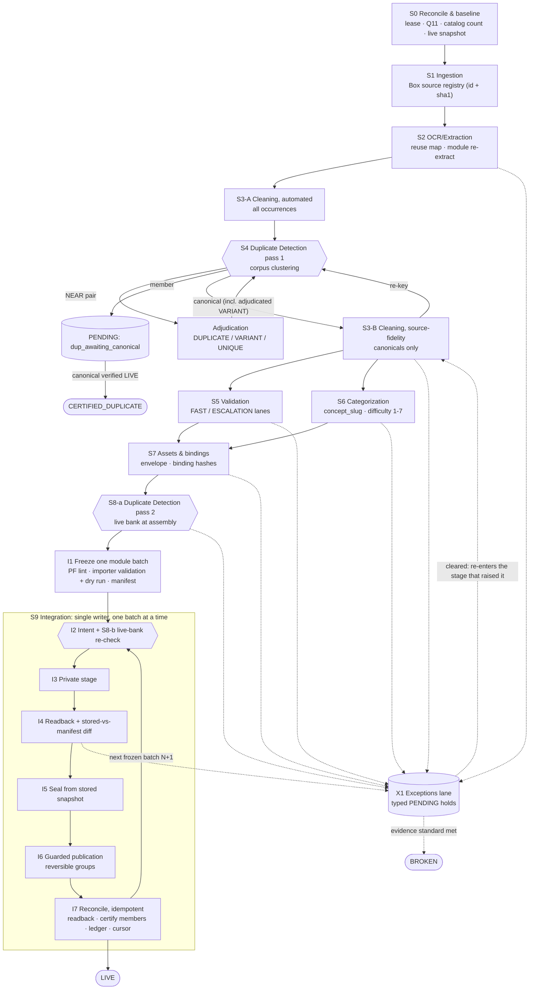

# Released-exam question import: optimized workflow

- **Date / status:** 2026-10-17. Proposed revision, adopted phase by phase (§17). Releases continue under the baseline process until each new tool passes its acceptance check.
- **Baseline:** optimizes `docs/ingestion/question-import-process-2026-10-17.md` (cited as **PD §n**). It does **not** replace it: the baseline's evidence rules, terminal-outcome definitions, recovery branches and gates stay authoritative. Where this document is silent, the PD applies.
- **Companion analysis:** `docs/ingestion/released-exam-import-current-state-analysis.md` (value stream, waste evidence, GitHub main vs. `karman-release` drift, services matrix, yield arithmetic).
- **Audience:** the owner (Zakaria) and the Claude Code agents continuing the import. All speed comes from removing waste around the existing gates. No gate is removed or relaxed. Duplicate detection also runs before PD §4–5 (S4) and again after S7 (S8); the PD release gates (importer validation, private stage, seal, guarded publication, readback) keep their order, and the ≤ 5-item visual check stays after publication (I7).
- **Start here.** Mac and `karman-release` reachable → P0 (§17): run S0 by hand (§3): writer check, the Q11 recovery branch, the catalog-scope baseline, the focused regressions, the cursor; then P1. Mac offline → no DB writes; start P3, the S1 source registry (§4), which needs only Box listings. Releases continue under the PD meanwhile.

## 0. Conventions

- **Labels.** **M** measured · **D** derived arithmetic from recorded timestamps or counts · **E** estimate · **[MEASURE]** unknown until measured. Every number below carries one.
- **IDs.** S0–S9 = stages (§2.2; section n covers stage n−3); I1–I7 = writer steps in S9 (§12); X1 = exceptions lane (§13); L0–L5 = evidence-chain levels (§2.3); PF01–PF14 = preflight lint codes (§12.1); OD-n = open owner decision with its default (§19); P0–P7 = phases (§17); constraints 1–6 = the owner's constraints (§20); C0–C2 = correction classes (§6); Q11 = the interrupted US V2 RW M2 Q11 release (§3); Episode A = the Oct 16 04:56–07:08 release of 14 US V4 Math M1 questions; Episode B = the Oct 16 07:26–10:26 window, 2,525 → 2,624 (companion §4.2).
- **CIC = existing contract, confirm in checkout.** The production importer (`scripts/pdf-pipeline/import-reviewed-questions.ts`), catalog scope (`src/lib/question-bank/catalog-question-scope.ts`), the guarded publication gate, payload seals, answer-record binding hashes, classification envelope, ledgers, manifests and cursor live in the owner's local `karman-release` checkout (offline Mac). None is on GitHub main. This document invents no CLI flag, field name or schema for that code.
- **NEW** marks a proposed small file. Names follow repo conventions: drivers in `scripts/pdf-pipeline/*.mjs` (kebab-case), pure logic in `scripts/lib/*-logic.mjs` (logic that imports `@/` TS modules goes in `scripts/pdf-pipeline/*.ts` and runs via `npx tsx`, like `import-json-direct-row.ts`), Vitest in `src/lib/pipeline-v2/*.test.ts`, every file under ~700 lines. Proposed artifacts are used only when an existing artifact cannot carry the data.
- **Vocabulary is the PD's.** Source occurrence (ID `YYYY-MM_REGION_VN_SUBJECT_MN_QNN`, e.g. `2025-10_US_V1_MATH_M1_Q06`), selected inventory (5,794 occurrences / 62 exams), published catalog (app catalog scope, not raw `is_live`), checked / privately loaded / published (progress measures, never summed), terminal outcomes **LIVE / CERTIFIED_DUPLICATE / BROKEN**, working state **PENDING** with a precise reason, frozen manifest, private stage, seal, guarded publication, readback, ledger, cursor.
- **Approved services only (constraint 3).** Supabase; Cloudflare Worker `karmanprep` + R2 via the existing binding; Clerk (admin session); GitHub + Actions; Box (source of truth for PDFs); Gemini (figure bbox and crops per ADR 0004; answer-key pages and figure structure as already wired in `extract-answer-key.mjs` / `extract-figure-structure.mjs`; plus its existing visual-verifier roles in `grader-roles.mjs`); Anthropic Claude (solving, QA, Opus as arbiter; Opus roles are wired in code without an ADR, the vendor is approved, see companion Q-D2). Local tools: Poppler `pdftoppm`, sharp, SymPy (`scripts/python/sympy-check.py`), KaTeX, pdfplumber, Tesseract (optional), Node/TS, Vitest. Kimi K2.5 (Moonshot), DeepSeek and Llama (and their carriers OpenRouter and Groq) are wired but have no ADR: not used in this workflow until the owner ratifies them (OD-3); even then no new role and never required for a quorum. **Not used:** Mathpix, Mistral OCR, marker-pdf, embedding APIs, OpenAI for import.

## 1. What changes and why

| # | Current practice / gap (source) | Revised step | Waste removed | Expected impact |
|---|---|---|---|---|
| 1 | Manual resume after interruption; Q11 left with a publish claim and no readback (PD §13) | **S0** scripted reconcile: writer lease, recovery-branch classifier, write-ahead intent records | Waiting: up to ≈107–115 min lost in Episode A (D, upper bound) | Loss capped at the in-flight step + 10–20 min resume (E) |
| 2 | PD §12.6 already requires next actionable + preserved holds, but holds lack typed reasons and there is no ready buffer (historical cursor on Q06, PD:22) | Cursor = next actionable slice + holds by typed reason; ready buffer of 1–3 batches | Hidden WIP; holds are 24.5–37.8% at the latest per-exam checkpoints (D) | No ready work hidden behind a hold |
| 3 | Identity via saved index + package hashes; no Box-level PDF revision key (sha1) | **S1** registry from Box listings: file id + sha1, role, scope, pinned revision | Invisible supply (~18 subfolder-only forms), revision ambiguity (`202410usv1.pdf` has 3 sha1s), byte-identical copies | Complete denominator; no source processed twice |
| 4 | PD §3 reuse rule applied by hand; main's pipeline re-extracts whole PDFs | **S2** reuse map; re-extract only missing / defective / changed-sha1 items, one module per job | Re-extraction over-processing; non-reproducible whole-PDF runs | Re-extraction volume = [MEASURE], not the corpus |
| 5 | Normalize and review every occurrence, then dedup against the live bank (PD §4–6) | **S3-A** automated normalization → **S4** corpus clustering → review **canonicals only** | Over-processing of duplicates: 4.1–10.2% duplicates at the per-exam checkpoints (D) | 100–417 agent-hours saved per 1,000 member reviews avoided (E) |
| 6 | One live-bank dedup late in the flow | Two passes: **S4** corpus-wide, order-invariant; **S8** fresh live bank at assembly and as the writer's first step | Late discovery; per-PDF-only dedup on main | Constraint 6: cross-exam duplicates found before effort is spent |
| 7 | Same answer-review depth for every item | **S5** FAST lane (text-only MC, key agrees, no correction) vs. ESCALATION lane, with a sampling audit | Over-processing of easy items | FAST 2–4 vs. ESCALATION 8–20 min/q (E) |
| 8 | Figure default, missing envelope, missing binding hashes found at private stage or after publication | **PF01–PF14** preflight lint at the earliest stage and again at freeze | Defects caught late: up to ≈33% of the 07:26–10:26 window was rework (D, upper bound) | Rework share ≤ 5% (target) |
| 9 | Checkpoint deltas of +6 to +19 (release size not recorded); PD §15 already allows module-sized batches; readback, ledger and cursor run as separate post-batch steps (existing reconciliation logic, CIC) | Module-sized frozen batches, pipelined; one idempotent reconcile command | Fixed overhead per small batch; manual post-publish work | Plan at 43–49 q/h (D, upper bound: the current process's rework-free Oct 16 rate) vs. 29–33 q/h observed in Episode B and ≥ 18.4–20.5 q/h blended incl. the Episode A interruption (D) |
| 10 | Importer exists only on the offline Mac | Push the `karman-release` toolchain to a branch of the existing GitHub repo | Handoffs across disjoint locations | CI runs the 5 checks on a draft PR; agents can read the contract |
| 11 | Difficulty single-pass; silent defaults (main: import 4, DB 1) | **S6** two raters, explicit integer 1–7, PF04 blocks defaults | Silent defaults | No defaulted difficulty in any manifest |
| 12 | Evidence keyed to a version label (main) | Evidence chain L0–L5 bound to content hashes; PF08 flags stale evidence | Stale or unbound evidence | Review reused only when inputs are unchanged |
| 13 | No per-step timing | Step timestamps in manifests + metrics annex (§16) | Flow cannot be measured | Throughput measured (M) after 3 batches |

## 2. Pipeline overview

### 2.1 Flow

### 2.2 Stage summary

| Stage | Runs as | Input → output | Exit gate | Estimate |
|---|---|---|---|---|
| S0 Reconcile & baseline | Writer, start of every session | Checkpoints, manifests, DB read → Q11 outcome, baseline count, lease, live-bank snapshot sets, cursor | Q11 resolved; invariant holds; focused ledger/count regressions pass; one lease | First 1–2 h; then 15–45 min; target 10–20 min (E) |
| S1 Ingestion | Any Claude Code session with Box access (no Mac needed) | Box listings → registry row per file (id, sha1, exam key, role, scope, pin) | Every file has one row; selected subset = 5,794 occurrences | Build 0.5–1 day; run < 5 min (E) |
| S2 OCR/Extraction | Coordinator (map) + reviewers (one module each) | Registry, captures, packages → raw record per occurrence (L0–L2) + status | Every occurrence has a status; coverage met or gap recorded | Map: minutes; 15–30 agent-min per re-extracted module (E) |
| S3-A Cleaning, automated | Script | Raw record → normalized comparison text + flags | All occurrences keyed | Seconds per module (E) |
| S4 Duplicate Detection 1 | Script + adjudicators | All occurrence keys + live snapshot → cluster file, canonicals, `U_new` | One role per occurrence; fixtures pass | Run < 10 min; 1–5 min per adjudicated pair (E) |
| S3-B Cleaning, fidelity | Reviewer, canonicals only | Canonical + capture → frozen payload (L3) + correction records | Zero unmapped hunks; KaTeX passes | 1–3 / 5–10 / 10–20 min text / math / table (E) |
| S5 Validation | Reviewer, by lane | L3 → answer evidence L4 | Verified answer text/value or full set | FAST 2–4, ESCALATION 8–20 min/q (E) |
| S6 Categorization | Claude rater + reviewer | L3 → classification evidence L5 | Valid slug; explicit 1–7 with two ratings | 1–2 min/q, ≈ $0.04/q (E) |
| S7 Assets & bindings | Reviewer; upload campaign in one owner session | L3 + L4 + L5 → asset refs, envelope, binding hashes (CIC) | Every visual resolves; bindings from current payload | 10–30 min per asset review; 1–2 min per upload (E) |
| S8 Duplicate Detection 2 | Assembler (S8-a), writer (S8-b) | Batch + fresh exports of both S0 sets (catalog scope; all DB rows and recorded occurrence IDs) → decision bound to snapshot hash | PF09 clean | Minutes per batch (E) |
| S9 Integration | Single writer | Frozen manifest → LIVE rows, certified members, ledger, cursor, checkpoint | Row-level readback; invariant; second reconcile is a no-op | `F + v·B`, F 10–15 min, v 0.2–0.4 min/q (E); plan 43–49 q/h (D, upper bound) |
| X1 Exceptions lane | Reviewers; campaigns | Typed holds → cleared, or BROKEN with evidence | Every hold has reason, next action, age | [MEASURE]; per case ≈ 10–30 min asset review (S7), 8–20 min answer dispute (S5), 2–5 min capture repair (S2), 1–5 min adjudication (S4) (E) |

### 2.3 Roles, artifacts and evidence chain

- **Owner:** decisions (§19), a signed-in Clerk admin session for asset campaigns, anchor labels.
- **Coordinator / writer:** exactly one Claude Code session on the host that has `karman-release` and the authorized Supabase configuration (today the Mac). Runs S0, S8-b and S9; sole writer of DB, ledger and cursor; assigns slices.
- **Reviewers:** N parallel Claude Code sessions, one non-overlapping slice each (form × module = one occurrence-ID prefix, exact revision and hash inputs). Run S2 repairs, S3-B, S5, S6, S7 review and adjudication. Return records; never write DB, ledger or cursor (PD §15).
- **Assembler:** a reviewer role or the coordinator between writer steps. Runs S8-a, lint, importer dry run. No DB writes.
- **Workspace dependency:** only S1 is independent of the Mac. S2–S7 need the task workspace (captures, packages, evidence), which stays on the Mac unless the owner syncs it to an approved location (OD-14).
- **Artifacts kept and extended, names unchanged:** `release-source-occurrence-inventory.json`, `current-readiness-ledger.json`, `readiness-db-delta.json`, `pending-next-cursor.json`, `*release-manifest.json`, private snapshots, `october-question-continuation-<count>.json`, rollback SQL, source outcome files, reviewer evidence.
- **NEW artifacts, only if an existing one cannot carry the data (CIC first):** `release-source-file-registry.json`, `release-source-duplicate-clusters.json`, `release-intent-log.jsonl`.
- **Evidence chain** (one pure module; reuse `karman-release`'s payload hash if it has one, CIC): **L0** Box sha1 of the pinned PDF → **L1** capture hash + bbox → **L2** raw record hash → **L3** payload hash (canonical JSON, NFC, sorted keys, explicit nulls; includes asset content hashes, excludes storage URLs) → **L4** answer evidence → **L5** classification evidence. Each level records the hash of its input; a changed input marks everything downstream stale (PF08).

## 3. Stage 0: Reconcile & baseline

**Steps**
- Inspect the environment: real checkout or worktree, branch, uncommitted changes (preserve them), presence of importer, gate and catalog scope. Confirm no importer/publisher is running and no intent is open. Take the writer lease: until P2 ships it is manual (confirm no other session or terminal runs the importer or publisher, PD §13 step 1, and record holder session, host and start time in the session checkpoint); from P2 it is the first intent record (holder, host, started_at, expires_at). An unexpired lease held by another session means stop.
- Read the newest checkpoint artifacts by content timestamp and hash, not filename order: latest `*release-manifest.json`, private snapshot, source outcomes, `current-readiness-ledger.json`, `readiness-db-delta.json`, `pending-next-cursor.json`, `october-question-continuation-2624.json`.
- Reconcile **US V2 RW M2 Q11** through exactly one PD §13 recovery branch: *published and valid* → record readback, finish ledger and cursor, no re-import · *present privately and unchanged* → re-read snapshot, seal, continue through the gate · *absent* → retry only the scoped work through normal validation and staging · *partial or mismatched* → reconcile the exact affected IDs and associated records, resolve the discrepancy before any release, and keep them PENDING (`private_staging` if unpublished, `readback_uncertain` if published) until verified. Never increment 2,624 or re-insert from the last message.
- Baseline: count the published catalog through `catalog-question-scope.ts` plus row-level eligibility (seal, both answer-record binding hashes, skill pool), with timestamp. Report checked and privately loaded totals only if measured, otherwise "unknown".
- Refresh the four-category aggregate from manifests and decisions newer than the 09:57 / 10:08 snapshots (never mix timestamps). Check LIVE + CERTIFIED_DUPLICATE + BROKEN + PENDING = inventoried occurrences. Run the focused ledger/count regressions (36 passed at the Oct 16 checkpoint; suite and invocation CIC).
- Once S1 exists: diff Box sha1s against the pinned registry; a changed sha1 marks affected evidence stale (no re-extraction yet).
- Export two read-only sets with hashes, for S4 and S8: (a) catalog-scope rows (IDs + comparison fields; the only valid CERTIFIED_DUPLICATE targets); (b) every non-archived question row in any state (private stage, non-catalog `is_live`, `needs_review`) plus every occurrence ID already recorded as staged or imported in manifests and ledgers. A match in (b) blocks insertion (PD §6 step 1); certification is only against (a).
- Write a restart checkpoint and cursor: next actionable slice plus preserved holds (e.g. the `2025-10_US_V1_MATH_M1_Q06` asset hold).

**Tools / automation:** `karman-release` importer, gate, catalog scope, the focused ledger/count regressions and ledger reconciliation logic (invocation CIC). NEW `scripts/lib/release-recovery-logic.mjs` (pure: classifies the recovery branch from manifest + intent + readback) with `src/lib/pipeline-v2/release-recovery-logic.test.ts`.

**Integration points:** catalog scope, publication gate, ledger, delta file, cursor. Lease and intents live in the batch's `*release-manifest.json` if its schema accepts additive fields (CIC), else in NEW `release-intent-log.jsonl` beside `pending-next-cursor.json`.

**Exceptions:** Mac or `karman-release` unavailable → no DB writes, run only S1, report "baseline unknown". Another writer suspected → identify it by exact IDs and scope before concluding (the 2,525 vs. 2,707 lesson, PD §2). Expired or denied approval → stop retrying, name the blocker (PD §14).

**Exit criteria:** Q11 is LIVE with readback or carries a typed PENDING reason · invariant holds · tests pass · exactly one lease held.

**Estimate:** first session incl. Q11 1–2 h (E); later sessions 15–45 min (E); 10–20 min once reconcile is automated (E, [MEASURE]).

## 4. Stage 1: Ingestion (source registry)

**Steps**
- List Released_Exams and every subfolder (`!Remove_Formatting`, `Archive`, `No_Answers` and children) from Box: file id, sha1, path, size, modified. Input is a Box folder listing exported as JSON (e.g. through the Box connector); the driver reads that file and holds no Box credentials. sha1 is the revision key; nothing is downloaded to identify a file. Fallback: local SHA-1 of the Box Drive copy.
- Parse names with the canonical grammar `^(\d{6})(us|asia)v(\d+)\.pdf$` → exam key `YYYY-MM_REGION_VN` (`202510usv1.pdf` → `2025-10_US_V1`). Apply a tested anomaly table; raw Box filenames are never renamed:
  - region alias `aisa` → `asia`; hyphenated version `asia-vN` → `asiavN` (`202405asia-v2`, `202406asia-v1`);
  - revision tags `-new`, `-Ver2`, `-Ver3`, ` copy`, `-1`, `_reformatted`;
  - scope tags `rw_only`, `-rw`, `-Reading_Writing_only`, `_noMath`/`_NoMath`, `Math_Module2_missing`, `-Full`/`-full`, `-screenshot`;
  - role tags (answer keys, explanations) `_Answers`/`-Answers`/`-answers`, `_Math_answers`, `_RW_answers`, `-Answers_MathONLY`/`ReadingONLY`, `_wAnswers`, `-Marked_Answers`, `_NoAnswers`; `AnswersExplained` = third-party explanations, not a key; types .txt/.docx/.png/.pdf;
  - never guessed, sent to the owner list (OD-4): `202403_March+A..D`, `202509us01..06` (proposed `US_V1..V6`, applied only after the owner confirms), the `202605math-105q` compilation, names without region or version (`202303-`, `202305-`, `202306-Full`, `202306-v2-Full`, `202310-`, `202311-`, `202312v1-full`, `202405us`, `202406us`).
- Collapse byte-identical files by sha1 into one source with aliases (the two ` copy` pairs).
- Pin one canonical revision per exam key (OD-5): the revision already bound to reviewed packages, else the most complete scope with a key, else owner. Alternates are whole-occurrence repair evidence only.
- Assign the occurrence-ID prefix in the existing convention (`MATH` confirmed; the R&W subject token is CIC).
- Parametrize expected coverage per form from its scope: each present module expects `EXPECTED_PER_MODULE` (27 R&W / 22 Math, `scripts/lib/extraction-validation.mjs:36`); full forms use `FLOORS`/`EXPECTED` (95/42/52; 98/44/54, `scripts/lib/extraction-coverage.mjs:37-48`). No fixed 98.
- Link answer-key artifacts to their exam key and scope, each pinned by its own sha1.
- Mark selected-inventory membership for the 62 selected exams (proposed additive field, e.g. `in_selected_inventory`); every other form is "registered, not selected" with a coverage line (incl. ≈18 subfolder-only forms).
- Flag PDFs over 18 MiB (27 at top level, M): render needed pages locally instead of uploading whole files.
- Re-run every session as a diff.

**Tools / automation:** Box (approved). Reuse `extraction-coverage.mjs`, `extraction-validation.mjs` (export `EXPECTED_PER_MODULE` in a small PR or mirror it with a parity test). NEW `scripts/lib/source-registry-logic.mjs` (pure parsing, anomaly rules, coverage), NEW `scripts/pdf-pipeline/build-source-registry.mjs` (driver, dry-run by default), NEW `src/lib/pipeline-v2/source-registry-logic.test.ts` (one fixture per anomaly class).

**Integration points:** extends `release-source-occurrence-inventory.json` with additive fields if its schema allows (CIC), else NEW sibling `release-source-file-registry.json` keyed by the same exam key and occurrence-ID prefix. Occurrence IDs feed ledgers, manifests and corpus-index joins unchanged.

**Exceptions:** missing module → form-level SOURCE-GAP (no occurrences created, never BROKEN) · unparseable name → owner list · same basename, different bytes → pinned revision + alternates; a material content difference opens `PENDING:revision_conflict`.

**Exit criteria:** every Box file (147 top level + 87 subfolder = 234, M) has one row or an "unparsed" row with a reason · selected subset reconciles to 5,794 occurrences · every exam key pinned or owner-flagged · every anomaly class has a passing test.

**Estimate:** build 0.5–1 day; run < 5 min; owner anomaly review 30–60 min once (E).

## 5. Stage 2: OCR/Extraction (reuse before re-extract)

**Steps**
- Join existing agent-a-output captures and saved A/B/C/D/CF packages to occurrence IDs on (form, module, question number) via `corpus-index.json` and per-exam indexes. Inspect package contents before joining (PD §3). Captures without a printed number go through the matcher pattern; record confidence, low confidence → review.
- Record the capture sha256 and a 16×16 average hash (aHash).
- Completeness check per occurrence: stem; passage (R&W); 4 choices or a numeric prompt; a figure when any signal says one is required (`questionReferencesVisual()`, the `HAS_FIGURE_HINT_RE` pattern in `audit-rules.ts`, a figure bbox detected on the capture or page, or the reviewer; `questionReferencesVisual()` alone is precision-tuned and misses phrasings such as "In the figure, …" and "… is shown."); continuation pages. Then module coverage against the S1 expectation, including duplicate question numbers.
- Detect screenshot-of-screen captures: aHash grouping of repeated UI chrome, UI-noise phrases ("mark for review", "directions"), the registry `screenshot` flag. A highlighted student selection is never used as the key.
- Classify each occurrence: **REUSE** (complete, sha1 unchanged) · **REPAIR** (named defect) · **RE-EXTRACT** (missing, defective or changed sha1) · **SOURCE-GAP** (form-level only, §13.1; an inventoried occurrence whose capture, page or module is missing stays `PENDING:missing_evidence`).
- Re-extract one module per job: render only needed pages of the pinned revision (`renderPdfPage`, 200 DPI); Gemini bbox and crop where needed; a reviewer agent (Claude) transcribes from the capture; an independent second reading (pdfplumber text layer where present, else Tesseract for prose, else a second agent); character-level diff, every disagreement becomes an uncertainty flag.
- Check each re-extracted module against its S1 per-module expectation (`EXPECTED_PER_MODULE`, 27 R&W / 22 Math), including missing and duplicate question numbers (the per-module logic behind `validateExtraction`'s `missing_/duplicate_question_numbers_by_section_module`). Ignore `validateExtraction`'s whole-form floor warnings and taxonomy/answer flags at S2; apply `analyzeCoverage` FLOORS only to a full-scope form after all its modules are assembled and classified. A module below its per-module expectation is **blocked**.
- Freeze the raw record (L0 sha1, L1 capture hash + bbox, L2 raw record hash). All later changes happen in S3 with correction records.

**Tools / automation:** `scripts/lib/question-matcher.mjs`, `visual-relevance-logic.mjs` (+ a port of the module-private aHash at `classify-visual-relevance.mjs:122`), `page-render.mjs`, sharp, `extraction-validation.mjs`, `extraction-coverage.mjs`, the `mapLimit` pool and 429 backoff patterns from `extract-with-images.mjs` (pattern only), pdfplumber, Tesseract. NEW `scripts/lib/capture-reuse-logic.mjs` + NEW driver `scripts/pdf-pipeline/map-capture-reuse.mjs` + test. Not used: Gemini for prose transcription (its RECITATION block refuses to reproduce copyrighted text), OpenAI vision, Kimi unless ratified (OD-3).

**Integration points:** corpus index; the reviewed-package format consumed by `import-reviewed-questions.ts` (CIC); source-lineage naming of evidence.

**Exit criteria:** every registered occurrence with a capture has a status (repair and re-extraction run only for selected occurrences unless OD-12 adds forms) · module coverage meets expectation or the gap is recorded with source evidence · no package mixes content from one revision with an answer from another (PD §3).

**Estimate:** mapping build 0.5–1 day, run in minutes (E). Re-extraction 2–5 agent-min per defective capture or 15–30 per module (E) × [MEASURE] count.

## 6. Stage 3: Cleaning (3-A automated normalization, 3-B source-fidelity corrections)

Cleaning is split so that reviewer time is spent only on canonicals (S4 sits between 3-A and 3-B).

**S3-A, automated, every occurrence, before S4**
- C0 representation-only normalization of a working copy by an idempotent script: NFC, trailing/duplicate spaces, and joins of soft-wrapped lines inside a prose paragraph only (hyphenation, mid-sentence wraps). C0 never removes a line break in poems/verse, lists, tables, titles, line-numbered text or between paragraphs. Each C0 operation is logged by type so PF12 can verify it is allow-listed. The working copy feeds S4 keys; payload line structure is set in S3-B from the capture.
- Build the comparison text with the S4 normalizer (§7). Never written to the payload.
- Deterministic pre-screens recorded as **flags, not edits**: `detectAllPatterns` (Math only; detection only, never chain `applyRepair`), `auditRow`, `deterministicWellFormednessChecks`, renderer-parity math-span parser (defined under S3-B) + strict KaTeX, stem-duplicates-passage, choice distinctness.

**S3-B, reviewer, canonicals only, after S4 elects them**
- Correction classes (the source-fidelity contract, constraint 1):
  - **C0** representation only, by script, in the renderer representation `karman-release` accepts (CIC).
  - **C1** OCR restoration: dropped exponent, parenthesis, sign, letter, subscript or fraction structure, only where the capture shows it. Each writes `{field, original, corrected, reason, capture ref, reviewer}`. Applied in one pass on original offsets, right to left.
  - **C2** answer-key correction: only through the S5 escalation lane.
  - **Forbidden:** proofreading the author's wording; changing numbers, variables or labels to make a table fit; reordering choices; adding punctuation not in the source; any spelling/grammar fix inside R&W conventions or expression items or underlined spans, where the error is the tested content.
- Restore meaning-bearing structure from the capture: passages, poem line breaks, blanks, exact underline/italic spans in the accepted markup (CIC; main escapes `<u>`), fractions, roots, exponents, units, requested quantity (PD §4).
- Misspellings: OCR-induced (capture differs) → C1 · printed and unambiguous → keep with a review note · printed and creating ambiguity → S5.
- Choose the figure representation explicitly: none (explicit null figure fields), native table, or reviewed asset (PD §4).
- Native tables by double entry (second entry = pdfplumber text layer, else a second agent): cell diff 0, numeric cells parse, caption/headers/order/units checked; a table/question conflict is never relabeled.
- Fidelity diff (PF12) runs field by field on payload text, never on the S4 comparison text: raw record vs. cleaned payload, NFC only, preserving case, punctuation, quotes/dashes, line breaks and `<u>`/italic span offsets. Every hunk that is not a logged, allow-listed C0 operation must map to a correction record.
- Strict KaTeX (PF10): extract math spans with the renderer's own parser (port the `MathText.tsx` `parse()` regexes into the preflight module with a parity test against MathText), not `extractMathSpans`, which mis-pairs delimiters around `\$`; then run local KaTeX `renderToString` in strict mode on each span.
- Compute L3, then re-key into S4: a new exact match merges the cluster. Any member whose S3-A keys no longer equal the canonical's pre-correction keys, or whose own capture does not support every C1 correction applied to the canonical, returns to `pending_adjudication` and is certified only after a NEAR adjudication against its own capture.

**Tools / automation:** `math-notation-patterns.mjs` (detection), `src/lib/question-bank/audit-rules.ts`, `scripts/pdf-pipeline/audit/check-well-formedness.mjs`, the `MathText.tsx` span parser (ported, parity-tested) + local KaTeX `renderToString` strict, `normalizeTableData` / `validateTableData` (`figure-extraction-logic.mjs`), pdfplumber. NEW `scripts/lib/fidelity-diff-logic.mjs` + test.

**Integration points:** payload in the importer's reviewed input contract (CIC); correction records go in the existing evidence format and double as the ML "original vs. normalized" signal.

**Exceptions:** unreadable capture → alternate revision of the same occurrence → re-elect a complete member as canonical (whole-occurrence swap; never copy content from another occurrence) → `PENDING:extraction_repair` · unsupported markup on the target → `PENDING:renderer_support`.

**Exit criteria:** zero BLOCKING findings among content-only codes (PF01, PF10, PF12, PF13; `auditRow` A2/A17/C6/B1/B5/C4/F7; well-formedness choice checks; answer, difficulty and explanation codes apply later, §12.1) · zero unmapped hunks · KaTeX passes · table cell diff 0 · L3 recorded.

**Estimate:** S3-A seconds per module (E). S3-B text 1–3, math with repair 5–10, table 10–20 min per canonical (E, [MEASURE] mix).

## 7. Stage 4: Duplicate Detection, pass 1 (corpus clustering)

Runs over **every registered occurrence that has a raw record (L2), plus both S0 snapshot sets**, before answer validation, assets and classification. Pure local code; no external service. Until OD-12 is decided, only selected occurrences and live rows can be elected canonical; unselected occurrences join clusters as non-canonical evidence.

**Unified normalizer** (one function used everywhere; versioned `NORMALIZER_VERSION`; comparison only, never written to the payload). Order matters:
1. Pre-map math-significant compatibility characters to tokens: superscripts → `^n`, subscripts → `_n`, vulgar fractions → `a/b`, U+2212 → `-`, `×` → `*`, `÷` → `/`; keep `≤ ≥ ≠ √ π`.
   1a. Canonicalize LaTeX to the same tokens: `\times`/`\cdot` → `*`, `\div` → `/`, `\le(q)` → `≤`, `\ge(q)` → `≥`, `\ne(q)` → `≠`, `\frac`/`\dfrac`/`\tfrac{a}{b}` → `(a)/(b)`, `^{n}` → `^n`, `_{n}` → `_n`, `\sqrt{x}` → `√(x)`, `\pi` → `π` (mixed Unicode/LaTeX is a known corpus condition, `F3_unicode_latex_mix` in `audit-csv.mjs`).
2. Strip markup for comparison: `<u>`, italic markers (their span offsets are kept separately as `K_markup`), `$`/`$$`, `\( \)`, `\left`/`\right`, thin spaces (other LaTeX command names kept).
3. NFKC → casefold → straight quotes, unified dashes, `…` → `...`.
4. Collapse whitespace (hash keys remove all whitespace; similarity keeps single spaces). Digits, units, signs and variable names are kept.
- Tested properties: idempotent; `x²` ≠ `x2`; curly = straight quotes; reflowed text equal; `3 \times 4` = `3 × 4`; `x^{2}` = `x²`; `\frac{1}{2}` = `½`.

**Keys and fingerprints**

| Key | Definition | Use |
|---|---|---|
| `K_occ` | Occurrence ID | Same `K_occ` = revision, never a duplicate |
| `K_ctx` | sha256 of norm(passage fields) + canonical table cells | Context identity (prevents cross-text collisions) |
| `K_stem` / `K_choiceset` | sha256 of norm(stem) / of **sorted** norm(choices), `NUMERIC` for numeric entry | Blocking; order-invariant |
| `K_markup` | Normalized character offsets of `<u>`/italic spans (after S3-B restores them; live rows as stored) | Underline/italic identity |
| `K_exact` | sha256(subject, answer format, `K_ctx`, norm(stem), `K_choiceset`, `K_markup`) | Excludes domain, classification, choice positions |
| `K_answer` | `K_exact` + norm(correct answer **text**) or sorted numeric set | Null until an answer is known |
| `F_num` / `F_fig` | Sorted multiset of number tokens from context, stem and choices (NEW tokenizer, each kept with its unit/percent marker; `normalizeNumeric` only parses each token) / figure aHash or table-cell hash | Variant signals |
| parity | `computeContentHashV2` (`import-core.ts`) | Matching existing live rows only |

**Steps**
- Compute keys for all occurrences. Candidate pairs = equal `K_stem`, `K_ctx` or `K_choiceset`; OR an equal 40-character prefix of the normalized stem (a NEW blocking key; not `question-matcher.mjs`'s `prefixOverlap`, which only tests whether one whole string is a prefix of the other); OR a local shingle index (pairs sharing ≥ m rare normalized 5-gram shingles of context + stem, or MinHash-LSH; pure local code) so every pair with `S_text` ≥ `T_near` is scored; OR `F_fig` Hamming ≤ 4 as in `groupByVisualSignature`.
- Score (`S_text` = char 5-gram Jaccard on context + stem; `S_choice` = share of choice texts in common; thresholds [MEASURE], OD-7) and classify:

| Class | Rule | Action |
|---|---|---|
| EXACT / REORDERED | `K_exact`, `K_answer`, `F_num` equal; no figure asset on either item (figure null, or native tables with equal cell hash) (REORDERED: positions differ) | Auto duplicate; letter mapping recorded by text |
| EXACT-PENDING-ANSWER | `K_exact` equal, one or both `K_answer` unknown, no figure asset | Provisional; confirmed at certification |
| EXACT-ANSWER-CONFLICT | `K_exact` equal, `K_answer` differs | `PENDING:answer_dispute` on the cluster |
| NEAR | `S_text` ≥ `T_near` (E 0.90) not EXACT, or `S_choice` ≥ 0.75 (E, OD-7) with equal `K_ctx`, or equal keys on a figure-asset pair, or equal stripped text with different `K_markup` | Adjudication only, never automatic |
| VARIANT candidate | Blocked pair, not EXACT, with `S_text` ≥ `T_near` or equal `K_stem`, where `F_num`, `F_fig`, answer format or requested quantity differ | Adjudication only (PD §6 variant review): DUPLICATE / VARIANT / UNIQUE; both stay `pending_adjudication` until decided; never auto-suppressed, never auto-released as separate |
| REVISION | Same `K_occ` | `revision_alias` of the pinned occurrence |

- Union-find over EXACT, REORDERED and EXACT-PENDING-ANSWER edges (provisional until the canonical's verified answer exists). Adjudicated DUPLICATE attaches a member to the canonical as a star; NEAR decisions never chain.
- Adjudicate NEAR pairs on full passage, data, figure, choices, requested quantity and answer value → DUPLICATE / VARIANT / UNIQUE, with reviewer and hashes.
- Elect one canonical per cluster: an already-LIVE member always; else best source quality (complete capture → printed/linked key on pinned revision → representable figure → not a screenshot → fewest flags/corrections → full exam over partial/compilation); ties → lowest occurrence ID.
- Emit the cluster file and unique supply: `U` = clusters across the registry, `U_live` = clusters with a LIVE member, `U_new` = `U − U_live`; re-run the yield decision rule (§15).

**Certification rule (applied in S9 I7).** A member becomes CERTIFIED_DUPLICATE only if: its canonical is LIVE by row-level readback under catalog scope · the relation is EXACT/REORDERED/EXACT-PENDING-ANSWER or an adjudicated DUPLICATE · the member's printed answer (if any) maps by text/value to the live answer (a key-less member is certified by text mapping to the live answer; a printed key that maps to a different text goes to `answer_dispute`) · evidence is recorded (both hashes, keys, `NORMALIZER_VERSION`, choice mapping, live ID, time). A match to an unpublished candidate is a lead only (PD §6). Members inherit the canonical's labels in evidence; they are not separate production rows.

**Regression fixtures** (exact content copied from saved decisions, CIC): Asia V1 RW M1 Q23 vs. US V3 "Likewise" → REORDERED · triathlon 17.700 mph numeric vs. 19.3 mph MC → VARIANT candidate (adjudicated VARIANT) · generic stem with different data → VARIANT candidate · US V1 RW M1 Q06 vs. V2 → VARIANT (adjudicated, family link; both may be LIVE) · US V1 RW M2 Q06 one changed distractor → NEAR, `variant_review` (OD-6) · cross-text R&W same generic stem → not duplicates · same occurrence captured twice → REVISION · `x²` vs. `x2` → not equal · A NEAR B, B NEAR C → no chain · `3 \times 4` vs. `3 × 4` → equal · same text, different underlined span → NEAR · every CERTIFIED_DUPLICATE in the ledger refreshed in S0 (32 at 10:08 per PD:343, plus later decisions such as the US V1 certified repeats reported ~10:30) → reproduced or each difference explained.

**Tools / automation:** reuse `normalizeNumeric` (`grader-normalize.mjs`, token parsing only), `hammingDistance` (`visual-relevance-logic.mjs`), `computeContentHashV2` (`import-core.ts`); the prefix blocking key and shingle index are implemented in the NEW modules: `scripts/lib/dedup-normalize-logic.mjs`, NEW `scripts/lib/dedup-cluster-logic.mjs`, NEW driver `scripts/pdf-pipeline/cluster-occurrences.mjs`, NEW tests `src/lib/pipeline-v2/dedup-normalize-logic.test.ts` and `dedup-cluster-logic.test.ts`.

**Integration points:** both S0 snapshot sets (catalog scope for certification; all DB rows and recorded occurrence IDs for blocking); cluster roles feed the ledger's PENDING reasons and the cursor; NEW `release-source-duplicate-clusters.json` (existing naming style).

**Exceptions:** canonical becomes BROKEN or is held past the hold-age threshold (OD-13) → promote the next member and review it against its own source. The former canonical becomes a member of the new canonical; any private rows it has are quarantined with `PENDING:dup_awaiting_canonical` and never staged again. Members are never BROKEN by association.

**Exit criteria:** every occurrence has exactly one role: canonical (an adjudicated VARIANT is the canonical of its own cluster, with a family link), member, revision_alias or pending_adjudication · all fixtures pass · no cluster has two canonicals · every refreshed ledger CERTIFIED_DUPLICATE reproduced or explained.

**Estimate:** build 2–3 days incl. fixtures; run < 10 min for ≈12k occurrences; adjudication 1–5 min per pair × [MEASURE] pairs (E).

## 8. Stage 5: Validation (solvability and answers, risk-tiered)

**Lane router** (NEW `scripts/lib/answer-lane-logic.mjs` + test)
- **FAST lane** requires all: text-only multiple choice with explicit null figure fields · no C1/C2 record in this revision · a printed or linked key on the pinned revision, paired by **identity** (module + question number from the occurrence ID, never by position) · printed-key confidence ≥ floor (E 0.90) · lint clean · no open dedup or variant question.
- **ESCALATION lane:** everything else, including figures, tables, charts, **all numeric entry**, any correction, a missing key, a disagreement, a slug or difficulty conflict.

**Steps (both lanes, PD §5)**
- Confirm the item is coherent and sufficient (a determinate task).
- Blind independent solve of the exact displayed revision (L3); compare by answer **text or value** with the printed key; keep both. Letter-only agreement is never accepted.
- MC: exactly one defensible choice, mapped to its current letter. Numeric entry: the full valid response set.
- FAST: one blind solve by an approved provider; agreement after normalization completes validation; any disagreement → ESCALATION.
- ESCALATION: ≥ 2 blind solves from different approved providers (Anthropic Claude and Google Gemini via its existing verifier roles; Gemini for figure-dependent items). If Gemini returns RECITATION or errors, the item stays PENDING (`answer_dispute`, or `review` on a provider error) until a second-provider solve or owner adjudication; a second Claude solve does not satisfy provider diversity; SymPy + `areExpressionsEquivalent` for algebraic/numeric equivalence; cell-by-cell table check; a **blind** arbiter that sees neither the stored key nor prior votes (main's escalation prompts include the stored answer, so the reviewer protocol uses blind prompts); adjudication of any remaining disagreement.
- Printed key overridden only with ≥ 2 agreeing blind solves from different providers on intact content; printed key and reasoning preserved (PD §5); `answer_source = inferred` (existing convention, `docs/ingestion/routine.md:254`). `hand_corrected` only when the key artifact visibly carries a manual correction (e.g. a `-Marked_Answers` file; `stage1-manual-extraction-prompt.md:512`). DeepSeek and Llama are never required for quorum.
- Numeric answer sets (NEW `scripts/lib/numeric-answer-set-logic.mjs`): derive every valid value under the prompt's constraints plus equivalent forms; test the `karman-release` grader with valid forms and near-invalid values (2.4/4.8; 7/3 and 2.333 accepted, nearby values and an inapplicable root rejected). Never widen tolerance to imitate a set. Multi-value sets go only to a target with confirmed set support (CIC; main grades one `correct_answer`).
- Sampling audit (OD-8, E): re-solve 10% of the first 300 FAST items at escalation depth, then 5%. Any miss demotes that item class (subject × domain × format) to ESCALATION until 100 consecutive clean audits (E).

**Tools / automation:** reviewer agents (Claude) as solvers; `grader-normalize.mjs` `answersEquivalent` with `answerFormat: "numeric_entry"` only (numeric match, then SymPy); for multiple choice compare the chosen choice text with the key's choice text through the S4 normalizer (§7), never via `answersEquivalent`, which compares letters; `math-equivalence.mjs` + `sympy-check.py`, `answer-key-logic.mjs` thresholds, `grader-roles.mjs` vocabulary for provenance; Gemini 2.5 Flash/Pro for visual checks. DB-bound `verify-answers.mjs` is **not** run on candidates; only its pure modules are reused.

**Integration points:** answer evidence and binding format of `karman-release` (CIC); `answer_source` values `extracted | inferred | hand_corrected`.

**Exceptions:** wrong printed key, missing key, ambiguous/unsolvable → §13. All solvers failed → infrastructure reason (`review`), never a content outcome.

**Exit criteria:** verified answer text/value mapped to its current choice ID, or a verified full set · determinacy confirmed · L4 current (bound to L3 and source sha1).

**Estimate:** FAST 2–4 min/q, ESCALATION 8–20 min/q, FAST share 50–70% (all E, [MEASURE]); blended ≈ 3.8–12 min/q (D from E). Cache hit on unchanged evidence ≈ 0.5–1 min/q (E).

## 9. Stage 6: Categorization (difficulty 1–7, concept_slug, domain, node)

**Steps**
- `concept_slug` (89 values = 89 curriculum nodes) is the **single** classification decision. Derived, never chosen: `domain` (`SLUG_TO_DOMAIN`), `topic_cluster` (`CLUSTER_BY_DOMAIN`), `node_id` (`nodeIdFromSlug`), subject (`subjectFromDomain`). "Skills" = the 89 slugs unless the owner decides otherwise (OD-1).
- A Claude rater picks the slug with a confidence. Existing thresholds (`check-slug-alignment.mjs`): assigned confidence < 0.7, or the rater says the slug does not fit and suggests another → adjudicator (Opus in the existing script); rater rejects the slug and suggests a different one at ≥ 0.85 → BLOCKING → `PENDING:classification_review`. Validate with `isValidSlug`, `isValidDomain`, `isValidNodeId` and the `section_domain_mismatch` check (catches R&W command-of-evidence items mislabeled `data_analysis`).
- Difficulty: **integer 1–7 only** (`quiz_questions.difficulty_level` CHECK 1..7). Rubric = KarmanGPT level descriptors (`question-imports/chatgpt/KarmanGPT.txt`), version-pinned by hash, anchored on target first-try success ≈ 85% L1–2, 65% L3–4, 40% L5–6, 15% L7, plus observable features the raters already reason over (steps, setup complexity, concepts combined, passage length/vocabulary, inference span, plausible distractors, figure/table/data use, answer format, expected time).
- Two raters: **R1** Claude model rater with the rubric, blind to R2 · **R2** the reviewer who validated the item, recording its rating before seeing R1 · adjudicator Claude Opus or the owner.
- Rules: equal → accept · differ by 1 → keep R1, record both (OD-9) · differ by > 1 → adjudicate with rubric evidence · missing rating → `PENDING:classification_review`, never a default (PF04). No fractional, zero or "unrated" level.
- Record provenance (L5): rubric version, raters (role, model), both values, features, adjudication note, time; per-wrong-choice `internal_category` labels (`INTERNAL_CATEGORIES`; optional, set by the explanation_v2 generator) when an explanation exists, otherwise null.
- Members inherit the canonical's labels in evidence at certification.
- Calibration: the owner labels an anchor set (OD-10). R1 is re-run on it after any rubric or model change and must stay within 1 level on ≥ 90% (E) before its ratings are used.
- Later recalibration from `question_responses` first-try success may move an item only between integer levels 1–7, using an owner-approved per-level mapping. The KarmanGPT success targets (four bands) are anchors, not storable categories; no band label or band value is ever written as a difficulty.

**Tools / automation:** `scripts/lib/taxonomy.generated.mjs` (`DIFFICULTY_LEVELS`, `CONCEPT_SLUG_VALUES`, validators), `src/lib/question-bank/taxonomy.ts`, `extraction-validation.mjs`, slug-alignment thresholds and prompt pattern (the script itself reads the DB, so it is not run on candidates). NEW read-only `scripts/pdf-pipeline/report-node-difficulty-coverage.mjs` (node × level grid, 89 × 7 = 623 cells; ≈ 16 per cell at 10,000, D), used only as a tie-breaker among ready slices.

**Integration points:** classification envelope generated by the `karman-release` implementation in S7 (CIC); `difficulty_level` set explicitly in the reviewed input (never relying on importer or DB defaults).

**Exit criteria:** valid, section-consistent slug · explicit difficulty 1–7 with two rater records · L5 current.

**Estimate:** 1–2 agent-min/q; ≈ 2 rater calls, ≈ $0.04/q (E). Runs concurrently with S5 on the same L3.

## 10. Stage 7: Assets & bindings

**Steps**
- For every visual item, confirm the asset derives from the pinned page (L0, L1); check labels, units, geometry/data and choice association (PD §7).
- Missing figure: re-crop with `renderPdfPage` at 200 DPI + Gemini bbox, then alternate revisions of the same occurrence, then re-elect a complete member as canonical (whole-occurrence swap; never copy a figure from another occurrence).
- Asset campaign: one authenticated admin session, between writer batches, uploads all ready assets through the `karman-release` asset route (CIC; confirm it uploads without creating rows: main's `bulkImportRows` inserts a row with each image, while main's per-question upload `actionUploadQuestionImage` updates an existing row only; which routes karman-release keeps is CIC). If the confirmed route can upload only by inserting a row, do not use it for these items: keep `asset_hold`, record the finding and ask the owner for the supported asset-only path. Main's admin bulk importer caps decoded images at 2 MiB (`bulk-import.ts:88`); confirm the karman-release route's cap (CIC) and, where a cap applies, re-encode locally with sharp and re-review. Keep every returned reference.
- Write the reference into the payload and verify it resolves through the app's delivery path. L3 is unchanged (it hashes asset content, not URLs); asset-dependent `karman-release` hashes are refreshed.
- Generate the classification envelope and **both** answer-record version-binding hashes through the `karman-release` implementation, after content is final. Never fabricate or copy from another question or revision (PD §7).
- Text-only rows carry explicit null figure fields in the importer input (PF01).
- Explanations (OD-18): include an existing explanation only if it records the current L3 and L4 hashes; after any C1 or C2 change, omit it and generate one after LIVE.

**Tools / automation:** `page-render.mjs`, sharp, Gemini bbox, R2 via the existing Worker binding, Clerk admin session; `karman-release` envelope and binding code (CIC). Phase 9 structured chart/graph extraction is deferred (its scripts read `quiz_questions` rows).

**Integration points:** admin importer route `https://karmanprep.com/admin/questions/import` as recorded (PD §1); envelope and binding fields per CIC.

**Exceptions:** admin session signed out → reviewed assets stay `PENDING:asset_hold` (PD:207), `auth` recorded as the campaign's blocker; continue non-visual work · no faithful representation yet and the question needs the visual → `PENDING:missing_evidence`. Never a false no-figure flag or a manufactured URL.

**Exit criteria:** every visual item has a resolving, bound reference or a verified native table · bindings computed from the current payload.

**Estimate:** 10–30 min per asset review; 1–2 min per upload within a campaign; 5–15 min campaign setup (E).

## 11. Stage 8: Duplicate Detection, pass 2 (live-bank preflight)

**Steps**
- **S8-a (assembler, at batch assembly):** first look up each candidate's occurrence ID and source identity in set (b) and the ledger (PD §6 step 1); a match is an already-imported occurrence and goes to the S0 recovery branches (never re-inserted, never a `revision_alias`). Then run the S4 keys and near-duplicate search against fresh exports of both S0 sets. Drop any candidate whose cluster is already LIVE.
- **S8-b (writer, first step of S9, immediately before private stage):** repeat, now including batch N−1's publications. The importer's source-identity, content-hash and stem guards stay the second line of defence (PD §6).
- Outcomes: EXACT/REORDERED match to a live row → leaves the batch, becomes a member of that live ID (certified in I7) · NEAR or VARIANT-candidate match → `PENDING:variant_review` · match to a non-catalog row in set (b) → blocked, `PENDING:review` with the row ID · guard rejection without equivalence evidence → `PENDING:variant_review` (PD §6) · re-freeze the passing subset.

**Tools / integration:** `dedup-cluster-logic.mjs` (NEW, shared with S4); `karman-release` importer duplicate guards (CIC); catalog scope export.

**Exit criteria:** dedup decision bound to L3 and the live-snapshot hash (PF09 clean); no two members of one cluster in the batch.

**Estimate:** minutes per batch (E).

## 12. Stage 9: Integration (single-writer release loop)

**Steps**
- **I1 Assemble and freeze (assembler).** Batch = ready canonicals of one module slice (≤ 27); two modules of one form are combined only if a module has < ≈12 ready items (E, OD-21). Run PF01–PF14 (§12.1); run the importer's existing validation and dry run/export on `import-reviewed-questions.ts` (invocation CIC); focused renderer and grading tests for the content types present (stacked fractions, roots/exponents, underlines, native tables, numeric sets); optionally `computePublishStatus` as an informational predicate. Freeze into the existing `*release-manifest.json`: stable IDs, payload/answer/asset hashes, proposed production IDs, rollback references, step timestamps.
- **I2 Writer begins.** Record the intent. Run S8-b. Re-run importer validation on the frozen records.
- **I3 Private stage.** Insert the scoped question, choice, answer and evidence records in private review state through the established workflow (PD §9).
- **I4 Readback and diff.** Read the exact stored records by expected IDs; compare field by field with the manifest (NEW `scripts/lib/stored-manifest-diff-logic.mjs`): explicit null vs. absent, figure fields, choice order, answers/sets, tables, classification, bindings. Includes the figure-default fixture.
- **I5 Fix and seal.** Fix the cause in the importer input (never a hand edit to pass a check), then correct the exact private rows through the supported path (or re-stage them), re-read them and repeat the I4 diff until it is empty (PD §9 step 5, PD:134). Only then compute seals from the **re-read stored snapshot** with the production student-payload code; save the private snapshot. Optionally pre-render up to 5 difficult items from the snapshot as an early check; this does not replace the I7 check.
- **I6 Guarded publication.** Existing reversible group sizes, bounded to reviewed IDs, an intent and outcome record per group. Never bypass a guard.
- **I7 Reconcile, one idempotent command** (extends the existing reconciliation logic, CIC):
  1. row-level readback of every released ID: catalog-scope visibility, content and choice order, answer/set, tables and figure fields, classification, both binding hashes, payload seal, asset deliverable, skill-pool eligibility; render at most 5 representative difficult released items through the production student path at narrow and wide widths (PD §11);
  2. grading checks for new numeric representations;
  3. certify every not-yet-certified member whose canonical is LIVE by row-level readback, whether released in this batch, already LIVE in the S0 snapshot, or an S8 match (re-read that live ID first) (S4 certification rule, §7);
  4. update occurrence outcomes; check the invariant; reconcile the count delta to exact IDs (new rows separate from metadata repairs, already-live matches, out-of-inventory changes);
  5. write the cursor (next actionable slice + holds by reason) and `october-question-continuation-<count>.json` (existing pattern);
  6. run the focused ledger/count regressions (extended); record the verified outcome.
  A second run is a no-op. A crash between publication and ledger is resolved by readback, never by re-insert.
- **Deployment.** If a batch depends on renderer/importer code, verify the deployed revision through the project's actual deployment workflow before releasing (PD §10). This workflow establishes no deploy command. Production runs application code that GitHub main lacks (catalog scope, seal and binding code, numeric answer sets, `<u>`): never run `cf:build`/`cf:deploy` from a GitHub-main checkout for this work. Deploying from the `karman-release` checkout is an owner action (path CIC), and there only as the pair `npm run cf:build && npm run cf:deploy`.

**Tools / automation:** `karman-release` importer, gate, seal and catalog scope (CIC). NEW `scripts/pdf-pipeline/import-preflight-logic.ts`, run via `npx tsx` (as `orchestrate.mjs` runs `import-json-direct.ts`, because `import-core.ts` and `audit-rules.ts` import `@/` aliases), composed from `validateImportRow`, `auditRow`, `deterministicWellFormednessChecks`, the renderer-parity span parser and taxonomy validators, behind an explicit adapter from the karman-release reviewed-input contract (CIC) to the `ImportQuestionInput` / `AuditableRow` shapes (`validateImportRow` checks main's flat `choice_a..d` and an MC letter). NEW `stored-manifest-diff-logic.mjs`. Each with a Vitest file; drivers live on the `karman-release` branch because they need its contract.

**Integration points:** this stage **is** the existing import system: importer → private stage → seal → guarded publication → readback → ledger → cursor (PD §8–12). Main's `orchestrate.mjs`, `import-json-direct.ts`, `publish-gate.mjs` and admin row importer are not used to publish these items (on main, a row inserted with `import_status` null or `'ok'` is student-visible immediately through the generated `is_live` column; `publish_status` does not gate students).

**Exceptions:** guard or seal failure → re-read rows, trace the changed input, quarantine failing IDs with the exact PENDING reason, re-freeze the passing subset, continue · interruption → S0 recovery branches · unexplained count jump → compare scope and IDs first.

**Exit criteria:** every released row verified at row level · invariant holds · delta equals verified new IDs · second reconcile run is a no-op.

**Estimate:** writer cycle `T_w = F + v·B`, F 10–15 min, v 0.2–0.4 min/q (E, [MEASURE]). Plan at **43–49 q/h (D, upper bound)**, the rework-free Oct 16 rate (it assumes all 59 min of the repair windows were rework; companion §4.2), until 3 batches are measured. Assembly 3–6 min; reconcile 3–6 min automated (E).

### 12.1 Preflight lint (PF codes are lint identifiers in the style of `audit-rules.ts`, not DB fields)

| Code | Fails when | First stage | Blocking from |
|---|---|---|---|
| PF01 | Figure representation not explicit (omitted ≠ explicit null; Oct 16 `figure_kind='image'` incident) | S3-B | day 1 |
| PF02 | Classification envelope missing or incomplete | S7 | day 1 |
| PF03 | An answer record lacks either binding hash, or a hash was not computed from the current payload | S7 | day 1 |
| PF04 | `difficulty_level` absent, defaulted, non-integer or outside 1–7 | S6 | day 1 |
| PF05 | Slug invalid, or slug's domain/section mismatch | S6 | after 2 batches |
| PF06 | Numeric item lacks complete accepted-set evidence, or a set goes to a target without set support | S5 | after 2 batches |
| PF07 | Graded answer field differs from the verified answer (letter, text or value) | S5 | after 2 batches |
| PF08 | Any evidence level, or an included explanation, stale (recorded input hash ≠ current) | I1 | after 2 batches |
| PF09 | Dedup decision missing or older than the fresh live pass; CERTIFIED_DUPLICATE without live target; two cluster members in one batch | S8 | day 1 |
| PF10 | Unsupported markup, or KaTeX fails under renderer-identical parsing | S3-B | after 2 batches |
| PF11 | Asset reference missing, undeliverable or not bound to the revision | S7 | after 2 batches |
| PF12 | Fidelity diff has an unmapped hunk | S3-B | after 2 batches |
| PF13 | MC with < 4 choices, non-distinct choices, or stem duplicating the passage | S3-A | after 2 batches |
| PF14 | Payload's source sha1 is not the registry's pinned revision | S2 | after 2 batches |

Report-only codes switch to blocking once their false-positive rate is measured over 2 batches. While a PF code is report-only, the PD §8 preflight item it automates stays a blocking manual check at freeze (PF14 identity/revision; PF06/PF07 answer mapping or numeric set; PF08 current evidence; PF10 representation; PF11 assets; PF12 fidelity; PF13 completeness); report-only status changes only whether the lint stops the batch automatically.

Reused `auditRow` / well-formedness codes apply from the stage whose data they need: A3, A15, `mc_invalid_correct_answer_letter`, `numeric_empty_correct_answer` after S5; A7 after S6; D0/D1/D6/D7 (explanations) excluded under OD-18's default; C1_figure_missing suppressed when the figure representation is a native table (the check keys on `image_url` only).

## 13. Missing figures, tables, and unsolvable questions (exceptions lane X1)

### 13.1 PENDING reasons (map to existing ledger reason values, CIC; add a value only if missing)

| Code | PD category | Meaning |
|---|---|---|
| `review` | incomplete review | Validation/categorization incomplete, or infrastructure retry |
| `missing_evidence` | missing evidence | Capture, key or source page not yet located |
| `extraction_repair` | repairable extraction | OCR, crop, choice or table transcription defect under repair |
| `variant_review` | variant review | Near-duplicate or guard rejection awaiting adjudication |
| `dup_awaiting_canonical` | variant review (duplicate lead) | Member waiting for its canonical to become LIVE, or for certification against an already-LIVE row |
| `answer_dispute` | incomplete review | Printed key vs. solve, or same content with conflicting answers |
| `missing_answer_key` | missing evidence | No printed or linked key (policy OD-2) |
| `classification_review` | incomplete review | Slug BLOCKING, rater gap > 1, or missing difficulty |
| `asset_hold` / `auth` | asset/upload hold / authentication | Reviewed asset exists but is not uploaded or deliverable, including while the admin session is signed out (PD:207) / `auth` is recorded as the asset campaign's blocker, not as a second per-question code |
| `renderer_support` | none (new reason; nearest: essential asset/upload hold) | Target renderer or grader lacks support (`<u>`, numeric sets) |
| `revision_conflict` | missing evidence | Same basename, different sha1, material difference, awaiting pin |
| `private_staging` / `interrupted_release` / `readback_uncertain` | private staging / interrupted release / uncertain readback | Staged not sealed / intent without outcome / publication without row-level readback |

SOURCE-GAP applies only to a module that is absent from every pinned revision and has no occurrence rows in `release-source-occurrence-inventory.json`; it is recorded at form level and never counts as PENDING or BROKEN. An inventoried occurrence whose capture, page or module is missing stays PENDING (`missing_evidence` or `extraction_repair`) until the original sources are checked (PD:94), and leaves PENDING only as LIVE, CERTIFIED_DUPLICATE or BROKEN (§13.3). Removing occurrences from the selected inventory is an owner decision (OD-12) recorded in the ledger.

### 13.2 Routing table

| Case | Detection | Route | Status while open | Terminal condition | Evidence |
|---|---|---|---|---|---|
| Missing figure | Any figure-required signal (`questionReferencesVisual()`, `HAS_FIGURE_HINT_RE`, a detected figure bbox, the reviewer), capture has no figure; solver says not answerable | Re-crop pinned page (200 DPI + Gemini bbox) → alternate revision of the same occurrence → re-elect a complete member as canonical (no cross-occurrence patch) → reviewed asset or native table → asset campaign | `missing_evidence` → `asset_hold` | LIVE after delivery verified; BROKEN only if no revision has the figure and the item cannot be solved without it | Page refs per revision checked, crop hash, reviewer check, returned reference |
| Table (raster or garbled) | Figure classed as table; grid in capture; `validateTableData` fails | Native table by double entry (cell diff 0, numeric parse, caption, headers, units); if uncertain, reviewed asset | `extraction_repair` | LIVE after cell verification + shared-renderer check; a table/question conflict is held, never relabeled; BROKEN only if confirmed on every revision | Both transcriptions, cell diff, capture ref |
| Chart, graph, diagram | Figure classification; `questionReferencesVisual()` | Reviewed figure asset (crop or reviewed SVG); structured route deferred | `asset_hold` | LIVE when deliverable and bound | Asset hash; axes/labels/units/data check; reference |
| Screenshot of a screen | aHash UI-chrome groups, UI-noise phrases, registry `screenshot` flag | Crop to the question; if UI hides content, re-take from pinned PDF page or prefer a cleaner cluster member; ignore highlighted choice | `extraction_repair` | Normal flow; a screenshot is never a reason for BROKEN | Capture and re-crop hashes; note that the highlight was ignored |
| Misspelling / typo | Character diff between the two readings or against the pdfplumber text layer (detection only; no spelling rule exists in `audit-rules.ts` and none is added, so R&W conventions/expression items and underlined spans are never auto-corrected) | OCR-induced → C1; printed and unambiguous → keep with note; printed and ambiguous → S5 | none or `review` | LIVE (kept or corrected); never BROKEN for a typo unless meaning is unresolvable | Capture crop of printed text; record or note |
| OCR math loss | `detectAllPatterns`, strict KaTeX, text-layer diff, solve vs. key disagreement | C1 restoration in one pass; SymPy no-op check; escalation-lane solve on repaired payload | `extraction_repair` | LIVE after repaired payload solved and agreeing | Raw vs. repaired text, capture ref, solver records |
| Missing answer choice | < 4 choices, choice > 800 chars (bleed), truncated crop | Continuation page → alternate revision of the same occurrence → re-elect a complete member as canonical (no cross-occurrence patch) | `extraction_repair` | LIVE when complete; BROKEN only if every source lacks the choice | Page refs checked per revision |
| Missing module (partial exam) | Registry scope tag + module coverage | Search other revisions, subfolders, compilations; else form-level SOURCE-GAP | form-level gap (not PENDING) | Gap documented and reported as coverage outside the inventory | Registry rows and sha1s searched |
| Missing answer key | No key page, no linked key file | Link a key file (pinned by sha1) only when blind solves agree with it on every module item that has a solve, with zero disagreements (default until the owner sets a threshold, OD-2); else escalation lane (≥ 2 agreeing blind solves from different providers + SymPy + determinacy), `answer_source = inferred` | `missing_answer_key` | LIVE only if owner allows inferred keys (OD-2); otherwise stays PENDING; never BROKEN for a missing key | Key-file sha1 + agreement, or solver records |
| Wrong printed key | Blind solve disagrees by text/value | Re-check extraction first; escalation lane with blind arbiter; correct only with ≥ 2 agreeing solves from different providers on intact content | `answer_dispute` | LIVE with corrected answer (`answer_source = inferred`), printed key kept, reasoning recorded; BROKEN only if the source is genuinely ambiguous | Printed key, solves, arbiter, reasoning, L3 |
| Ambiguous / unsolvable | Solvers disagree, report not answerable, or > 1 defensible choice | Treat as extraction first (S2/S3) → alternate revisions of the same occurrence; re-elect a complete member if one exists → adjudication | `answer_dispute` / `extraction_repair` | BROKEN only under the evidence standard (§13.3); an upstream "broken" label is not enough | Defect statement, revisions checked, attempts |
| Duplicate of an unpublished candidate | Cluster has no LIVE member | Only the canonical proceeds; if it fails, promote the next member | `dup_awaiting_canonical` | CERTIFIED_DUPLICATE once the canonical is verified LIVE | Keys, relation, choice mapping, both hashes |
| Near duplicate / one changed distractor | NEAR class, S8 near match, importer stem-guard rejection | Adjudicate on full passage, data, figure, choices, requested quantity, answer value | `variant_review` | VARIANT continues as its own canonical; DUPLICATE becomes a member; one-distractor policy OD-6 | Side-by-side record, decision, reviewer |
| Same content, conflicting answers | Equal `K_exact`, different `K_answer` | Escalation lane on the canonical; check each member's printed key | `answer_dispute` | Members certified with mapping, or member key flagged as misprint | Both keys, solves |
| Revision conflict | Same exam key, different sha1, differing content | Pin a revision (OD-5); alternates = repair evidence | `revision_conflict` | Normal flow on the pinned revision | Both sha1s, diff record |
| Private-stage mismatch | I4 diff not empty | Keep private; fix cause in importer input; correct the exact private rows through the supported path, re-read until the diff is empty, then recompute evidence and seal (I5); add a lint rule + fixture | `private_staging` | LIVE after clean readback | Diff, corrected input, new seal |
| Interrupted release / uncertain readback | Intent without outcome; delta not explained by IDs | S0 recovery branches | `interrupted_release` / `readback_uncertain` | LIVE after readback, or re-staged normally | Intent/outcome log, readback, snapshot compare |
| Asset route unavailable | Upload or auth check fails | Queue for next campaign; continue non-visual work | `asset_hold` (campaign blocker `auth`) | LIVE after upload + delivery check | Asset hash, queue entry |
| Renderer/grader lacks support | PF06 or PF10 | Route only to a deployed target with confirmed support; never widen tolerance or strip markup | `renderer_support` | LIVE after a deployed-support test | Deployed revision, test result |
| Classification unresolved | Slug BLOCKING ≥ 0.85, rater gap > 1, missing level | Adjudicator decides | `classification_review` | LIVE with explicit slug and level 1–7 | All ratings, rubric version |
| All solvers failed; provider 429 / quota | Every solve errored; HTTP 429 or quota body | Backoff and retry a throttle; a daily/billing quota parks that provider only; move another slice | `review` (infrastructure) / job parked | Normal flow; never a content outcome | Error / provider log |
| Under-extraction | Module coverage below expectation | Block the module; re-capture targeted pages | `missing_evidence` | Normal flow; inventoried occurrences stay `missing_evidence` until resolved (SOURCE-GAP only for modules with no inventoried occurrences, §13.1) | Coverage report |

### 13.3 BROKEN evidence standard (all required)

- The precise defect, the capture, every pinned revision and every cluster member checked, the repair attempts made, why no correction can be justified, and the snapshot kept as a negative example in evidence JSON.
- Never use `softRejectQuestion` for BROKEN items (it hard-deletes and cascades, `rejected.ts:104`).

### 13.4 Hold-clearance campaigns

- Pareto of holds by reason every session; a campaign runs when its prerequisite exists (e.g. a signed-in admin session) and the reviewed-ready buffer holds ≥ 1 batch. Holds older than OD-13 (E 7 days) escalate.

## 14. Throughput & cadence

### 14.1 Model, cadence and WIP limits

- **System throughput** `TH = min(C_w, R · r_review · p_ready, supply)`. Writer capacity planning anchor **C_w = 43–49 q/h (D, upper bound)**; 60–100 q/h (E) is a hypothesis to test after 3 measured batches. With batch size `B` (questions) and `T_w = F + v·B`, B = 10 gives 32–50 q/h (E), which brackets the rework-free Oct 16 rate (43–49, D); the observed 29–33 q/h (D) includes rework.
- **Reviewer pool** `R = ceil(TH · t_canon / (60 · p_ready · e))`, with `t_canon` = 6–25 agent-min per canonical across S3-B/S5/S6/S7 (E, [MEASURE]), `p_ready` = share of reviewed canonicals that reach the writer without a hold, 0.6–0.85 (E), utilization `e` 0.7–0.9 (E); `r_review` = 60·e / `t_canon` canonicals per reviewer-hour. At TH 45 q/h: ≈ 6 reviewers (fast case) up to ≈ 45 (slow case). Reviewer capacity and coding-agent usage limits, not the writer, are the likely binding constraint.
- **Batch = one module.** Ready canonicals of one module slice (≤ 27); publication inside a batch uses the existing reversible group sizes.
- **Drum-buffer-rope.** Drum: the writer runs S8-b + S9 for batch N. On deck: batch N+1 frozen by the assembler. Rope: reviewers work N+2 slices. Production visual checks (≤ 5) run in N's reconcile (I7). When N's reconcile ends the writer starts N+1 with S8-b, which sees N's publications.
- **WIP limits.** Writer 1 batch (intent → reconcile) · frozen on deck ≤ 1 · reviewed-ready buffer 1–3 batches · reviewer 1 slice · adjudication queue ≤ ≈25 (E; answer disputes, then near-duplicates, then classification). Little's law: at 45 q/h and ≤ 60 min (E) freeze → LIVE, frozen WIP ≈ 45 items ≈ 2 batches (D from E); more only ages the live-dedup evidence.
- **Slice assignment.** A new slice (one occurrence-ID prefix, exact revision and hash inputs) is handed out only while the buffer is < 3 batches. Buffer ≥ 3 → reviewers move to hold campaigns; buffer < 1 → back to text-only slices.

### 14.2 Stall rule (PD §15)

No verified publication for 15 min → diagnose in order: (1) a writer step older than 15 min → guard-failure triage, quarantine, re-freeze the passing subset; (2) nothing frozen on deck → reviewers to text-only slices; (3) adjudication queue blocking → serve its head or freeze another slice; (4) external block (auth, quota, usage limit) → record the typed PENDING reason, move an independent slice. Never relax a gate.

### 14.3 Interruption-safe checkpoints

- After freeze: manifest hash. After private stage: snapshot. After each publication group: intent + outcome record. After reconcile: ledger, cursor, continuation checkpoint, verified outcome.
- Restart = S0. Every intent without an outcome goes through the recovery branches; reconcile is idempotent. Throttle (backoff) is kept separate from daily quota (park that provider only).
- Expected loss: the in-flight step + 10–20 min to resume (E), vs. up to ≈ 107–115 min in Episode A (D, upper bound).

### 14.4 Per-stage time and resource estimate for the remaining work (derived / estimated)

**Assumptions** (all to be replaced by measurements): scope **A** = selected-inventory pending 3,378 occurrences (09:57 snapshot, M, stale: predates the 10:08 duplicate update and the 10:26 release; refresh in S0) → ≈ 3,030–3,240 canonicals at 4.1–10.2% duplicates (D) → 1,966–2,206 new LIVE at the latest per-exam checkpoint yields (D). Scope **B** = A + the 6,126 raw captures beyond the selected occurrence count (11,920 − 5,794; includes revisions and re-captures of selected occurrences, PD:72) at u = 1 (upper bound; requires OD-12) → ≈ 8,530–9,110 canonicals → 5,531–6,206 new LIVE (D). FAST share 50–70%; writer 43–49 q/h; 8 writer-active hours per day (E).

| Stage | Unit time (E) | Driver | Scope A total | Scope B total | Resource |
|---|---|---|---|---|---|
| S0 | 1–2 h first; 15–45 min/session | sessions | ≈ 2–7 writer-h (D from E) | ≈ 5–16 writer-h | Writer (Mac) |
| S1 | build 0.5–1 day; run < 5 min | once + diffs | 4–8 agent-h + 0.5–1 owner-h | same | Coordinator, owner |
| S2 | map build 0.5–1 day; 15–30 min/re-extracted module | defective modules | 4–8 agent-h + [MEASURE] | 4–8 agent-h + [MEASURE] | Reviewers; Gemini bbox |
| S3-A | seconds/module | all occurrences | < 1 h compute | < 1 h compute | Script |
| S3-B | 1–3 / 5–10 / 10–20 min | canonicals × mix | inside `t_canon` ([MEASURE] mix) | inside `t_canon` | Reviewers |
| S4 | build 2–3 days; run < 10 min; 1–5 min/pair | NEAR pairs | 16–24 agent-h build + [MEASURE] adjudication | same build + [MEASURE] | Script, adjudicators |
| S5 | blended 3.8–12 min/q | canonicals | ≈ 190–650 agent-h | ≈ 540–1,820 agent-h | Reviewers; Claude, Gemini |
| S6 | 1–2 min/q; ≈ $0.04/q | canonicals | ≈ 50–110 agent-h; ≈ $120–130 | ≈ 140–300 agent-h; ≈ $340–365 | Claude rater, reviewer |
| S7 | 10–30 min/asset review; 1–2 min/upload | visual canonicals | [MEASURE] visual share | [MEASURE] | Reviewers; owner session |
| S8 | minutes/batch | batches | inside writer F | inside writer F | Assembler, writer |
| S9 | `F + v·B`; 43–49 q/h | new LIVE | ≈ 40–51 writer-h | ≈ 113–144 writer-h | Single writer |
| **All reviewer stages** | `t_canon` 6–25 min | canonicals | **≈ 300–1,350 agent-h** | **≈ 850–3,800 agent-h** | N reviewers |

**Totals (D from E, not commitments).**
- Writer: scope A ≈ 42–58 h ≈ 5–7 writer-days; scope B ≈ 118–160 h ≈ 15–20 writer-days. If 7,376 new LIVE existed: ≈ 150–172 writer-h.
- Reviewers: scope A ≈ 300–1,350 agent-h; scope B ≈ 850–3,800 agent-h; canonical-only review saves 100–417 agent-h per 1,000 member reviews avoided.
- Build of all NEW modules (P2–P5 + metrics): ≈ 10.5–14 agent-days (E), overlapping with ongoing releases. Owner: anomaly review, decisions, asset-campaign sessions ([MEASURE]).
- Calendar: Nov 2026 deploy target is 15 days (Nov 1) to 44 days (Nov 30) away (D; calendar days, assuming 8 writer-active hours every day; on weekdays only: 10 to Nov 1, 31 to Nov 30). Scope B's writer time fits before Nov 30 even at today's 33 q/h (S9 ≈ 168–188 writer-h + S0 ≈ 5–16 h ≈ 22–26 days, D), but not by Nov 1 at any measured rate. November feasibility depends on reviewer capacity (≈ 850–3,800 agent-h) and sufficient supply (§15), not on the pipelined writer rate.

## 15. Yield and the 10,000 target

- **Units.** An occurrence is not a unique question; only verified LIVE rows count as published. Remaining need: 10,000 − 2,624 = **7,376** (7,375 if Q11 verifies) (D).
- **Formula.** `NewLIVE = N_pend · p_live_sel + N_other · u · p_live_other`, with `p_live = 1 − p_dup − p_broken − p_hold_final`. `N_pend` = 3,378 (09:57, M, stale; refresh in S0); `N_other` = 11,920 − 5,794 = 6,126 raw captures beyond the selected occurrence count (incl. revisions and re-captures of selected occurrences, PD:72); `u` = distinct non-revision share of `N_other` ([MEASURE] by S1 + S4); `p_broken` ≈ 20 / 5,794 ≈ 0.35% of all inventoried occurrences, 0.83% of the 2,416 resolved (D); `y_h` = 1 − `p_hold_final` (share of canonicals that do not end in a hold); `y_h,max` = 1 − the lowest final hold rate the owner considers achievable (E, e.g. 0.90).
- **Latest per-exam source checkpoints (D, PD:365; reached after several release slices, not a first pass):** US V1 ~10:30 58.2% LIVE / 4.1% certified repeats / 37.8% held; Asia V1 ~09:39 65.3% / 10.2% / 24.5%. Holds, not BROKEN, are the main yield loss.
- **Projection at checkpoint yields (D; no further hold clearance; upper bound only in u, at u = 1):** 1,966–2,206 + 3,565–4,000 = **5,531–6,206 new LIVE**, a gap of 1,170–1,845 at those yields. All holds cleared: target needs u ≥ 0.71–0.79. Residual holds 10%: u ≥ 0.86–0.96. Later forms likely share more items across US/Asia (E direction), lowering every scenario.
- **Conclusion.** 10,000 from released exams alone is **not assured**; it needs near-total hold clearance and a favourable distinct-occurrence count.
- **Decision rule (after every S4 run).** Measure `U_new` (canonical clusters with no LIVE member across the registry). If `U_new · (1 − p_broken) · y_h,max < remaining`, escalate to the owner (OD-11): (a) accept a released-only total, (b) add sources, or (c) fill with ML-generated items.
- **Levers, by expected new LIVE per hour (E):** asset-hold campaigns in one admin session + native-table conversion · answer-key linking, alternate-revision repair and re-election of a complete cluster member · registry coverage of unselected and subfolder-only forms (OD-12; changes the reconciliation denominator, so only by decision) · wrong-key correction instead of BROKEN · variant retention · canonical-only review (no yield itself, frees hours for the first three). Each 10-point cut in the final hold rate across ≈ 9,504 remaining occurrences adds up to ≈ 950 LIVE (D, at u = 1).
- **Released vs. generated.** Every record carries an origin marker (`released_official` or `generated`) in the ledger and evidence JSON (no new column; a column is an owner decision). Generated items are reported on their own line and never counted as released. If OD-11 chooses (c), generated items enter S8 like any canonical: S4 keys and near-duplicate search against every released occurrence in the cluster file, the live bank and other generated items; any EXACT/REORDERED/NEAR match is rejected or adjudicated before staging, and a generated item is never a CERTIFIED_DUPLICATE target for a released occurrence.
- **Evidence the ML generator needs, captured as a by-product (no extra LLM pass, no migration):** occurrence identity and pinned revision; original vs. normalized content (correction records; existing `raw_question_text`/`raw_choice_text`); answer provenance (`answer_source`, printed key, solves); classification provenance (raters, rubric version, features); distractor categories (`INTERNAL_CATEGORIES`); dedup/variant family decision; explicit figure representation; release events; BROKEN and held snapshots as negative examples.

## 16. Metrics & progress report

**Compact report after every batch (aligned to PD §17)**
1. **Published catalog:** verified total, timestamp, scope, new verified IDs and count since the last checkpoint.
2. **Selected source progress:** LIVE / CERTIFIED_DUPLICATE / BROKEN / PENDING with inventory scope and time; registered-but-unselected coverage on a separate line.
3. **Checked and privately loaded:** separate measured values or "unknown" (checked = occurrences whose source/content (L3) and answer (L4) reviews are current for the identified revision; state scope; canonicals and reviewed members counted once each; privately loaded = staged rows whose intent has no publication outcome).
4. **Cleaned candidates needing only deduplication ("Total possible questions"):** measured under the owner's definition (OD-15; proposed: canonicals with S3-B through S7 complete, not LIVE) or "unknown".
5. **What changed:** releases, certified live duplicates, supported fixes, genuine source defects.
6. **Next action:** exact source/module/question, or the access or asset step required.

**Flow and integrity annex**

| Metric | Definition | Target |
|---|---|---|
| Throughput (M) | Verified new LIVE / (reconcile end − intent start), per batch and session | ≥ 43 q/h after P6 (E) |
| Batch cycle time | Intent → reconcile end | [MEASURE] |
| Writer idle % | Time with no batch in the writer / session time | < 10% (E) |
| Buffer depth | Reviewed-ready batches | 1–3 |
| Rework share | Writer minutes on private-stage/readback discrepancies / writer minutes | ≤ 5% (vs. up to ≈ 33%, D) |
| Private-stage discrepancy / readback failure rate | Non-empty I4 diffs / staged rows; I7 failures / published rows | ≈ 0 / 0 |
| PF false-positive rate | PF failures overturned on review / PF failures | Measured before blocking |
| FAST share; FAST audit misses | Share of canonicals in FAST; audit disagreements | [MEASURE]; 0 |
| Rater within-1 agreement | R1 vs. R2 | ≥ 90% [MEASURE] |
| Holds by reason and age | Count and age per PENDING code | Falling every report |
| Unique supply; yield model | `U`, `U_live`, `U_new` with `NORMALIZER_VERSION`; refreshed `u`, `p_dup`, `p_broken`, `y_h` | n/a |
| Coverage grid | Node × level cells below the owner floor | n/a |

Every number carries a measurement time and a scope; nothing is summed across units. Never report raw occurrences, pending counts or a target as supply, a release before readback, or repaired metadata as new questions.

## 17. Implementation plan (phased, smallest first)

**Standing rule.** Keep releasing with the current process (PD §3–§13) while tools are built. A new tool replaces a manual step only after its acceptance check passes. Every new pure module ships with a Vitest file and passes the 5 required CI checks (TypeScript, ESLint, Prettier, Vitest, Cloudflare build). Pure modules that use no `karman-release` type (registry, reuse map, dedup, lanes, fidelity diff) go to main through `zakaria/<topic>` PRs; modules that read the manifest, importer or seal contract (preflight, stored-manifest diff, recovery, reconcile), and all drivers, go on the toolchain branch.

| Phase | When (E) | Items | Acceptance check |
|---|---|---|---|
| P0 Reconcile & baseline | Day 0 (needs the Mac) | Run S0 by hand per PD §13: lease, Q11 branch, catalog-scope count, aggregate refresh, focused regressions, cursor | Q11 has an evidence-backed outcome; baseline count + time recorded; invariant holds; tests pass |
| P1 Reproducible toolchain | Days 0–1 (owner) | Push `karman-release` importer, catalog scope, gate, seal/binding code, ledger tests, manifest schema to branch `zakaria/karman-release-import-toolchain` and open a draft PR into `main` (never merged) so `ci.yml` runs (it triggers only on push to `main` or a PR into `main`); preserve uncommitted work; secret scan; exclude PDFs and student data; ledgers only per OD-16. Commit this doc and the companion analysis with the PD in a separate docs PR to main | Branch builds; 5 CI checks pass on the draft PR; ledger tests that read real ledgers run locally until OD-16 allows fixtures to be committed; every CIC item resolved or listed |
| P2 Stop the rework | Days 1–3 | `import-preflight-logic.ts` (PF01–PF04, PF09 blocking; rest report-only), `stored-manifest-diff-logic.mjs`, `release-recovery-logic.mjs`, intent records, one idempotent reconcile, step timestamps | Fixtures replaying the recorded classes (Oct 16 figure default and missing binding hashes; the earlier missing envelope) plus main's defaulted-difficulty risk fail lint; reconcile twice → byte-identical ledger; writer killed between publication and ledger restarts with zero re-inserts and an exact delta |
| P3 Registry | Days 1–3 (Mac not needed) | `source-registry-logic.mjs` + driver + tests; owner resolves anomalies | ≈ 234 files have exactly one row; byte-identical files collapsed; every exam key pinned or flagged; selected subset = 5,794 |
| P4 Reuse map + early dedup | Days 3–5 (needs the Mac workspace unless OD-14 syncs it) | `capture-reuse-logic.mjs`, S3-A script, `dedup-normalize-logic.mjs`, `dedup-cluster-logic.mjs` with §7 fixtures; corpus run; `U_new`; decision rule | All fixtures pass; one role per occurrence; `U_new` reported with time and `NORMALIZER_VERSION`; owner informed if the rule triggers |
| P5 Lanes, classification, fidelity | Days 5–9 (needs the Mac workspace unless OD-14 syncs it) | `answer-lane-logic.mjs`, `numeric-answer-set-logic.mjs` + grader harness (CIC), two-rater protocol, `fidelity-diff-logic.mjs`, table double entry, evidence-chain currency | "0.5" agrees with "1/2"; 2.4/4.8 and 7/3 vs. 2.333 fixtures pass on the target grader; no defaulted difficulty in any manifest; zero unmapped hunks; remaining PF codes switch to blocking |
| P6 Pipelined cadence | Days 6–10 (needs the Mac) | WIP limits, slice assignment, stall rule, ≤ 5 production visual checks per batch (I7); 3 consecutive module batches | 3 batches published with full readback; throughput, cycle, rework share, FAST share, buffer depth measured (M); manifest step logs show no gate skipped |
| P7 Hold clearance + scale | Day 6 onward | Typed hold Pareto, asset campaign, key linking, variant adjudication, table verification, coverage grid; size R from measured `t_canon`; anchor set once labeled; registry-expansion decision | Every hold has reason, next action, age; hold rate falls every report; yield model refreshed with measured `u`, `y_h`, `p_dup` |

## 18. Do-not list

- No new importer or ad hoc writer; no schema redesign, migration or new column (origin/occurrence columns are owner decisions outside this workflow).
- No publishing these items through main's `orchestrate.mjs`, `import-json-direct.ts`, `publish-gate.mjs` or admin row importer until parity is confirmed (on main: visible at insert, `figure_kind` defaults to `'image'`, difficulty defaults to 4, no numeric sets, `<u>` escaped).
- No running DB-bound main scripts (`verify-answers.mjs`, `check-slug-alignment.mjs`, `extract-figure-structure.mjs`, `validate-katex.mjs`) against production rows for these items.
- No new external services (Mathpix, Mistral OCR, marker-pdf, embedding APIs, OpenAI for import); no use of Kimi, DeepSeek or Llama (or OpenRouter/Groq) until ratified (OD-3), never an expanded role, never required for quorum.
- No renaming of Box files or existing artifacts; no parallel naming scheme.
- No proofreading of source wording, number/label changes, choice reordering or tolerance widening.
- No new difficulty levels: no fractional values, no "unrated", no defaults.
- No auto-suppression of variants, no automatic near-duplicate decisions, no chain merges, no CERTIFIED_DUPLICATE without a verified LIVE target.
- No bypassing or relaxing duplicate, visibility, seal or binding guards; no fabricated or copied hashes; no manufactured asset URLs or false no-figure flags.
- No `softRejectQuestion` for BROKEN items; no unrelated repairs to old production rows.
- No screenshot audit of every question: at most 5 representative items per batch.
- No counting revisions, duplicates, holds or repaired metadata as new published questions; no mixing of timestamps.
- No `cf:deploy` without `cf:build` immediately before it, and never from a GitHub-main checkout for this work.

## 19. Open owner decisions

| ID | Decision | Default until decided |
|---|---|---|
| OD-1 | Are "skills" the 89 concept slugs/nodes? | Yes |
| OD-2 | May an item with no printed key go LIVE on ≥ 2 agreeing blind solves + SymPy (`answer_source = inferred`)? | No; stays `missing_answer_key` |
| OD-3 | Ratify via ADR, or exclude, Kimi K2.5 (Moonshot), DeepSeek, Llama and their carriers OpenRouter and Groq | Not used (no extraction, no votes) until ratified |
| OD-4 | Keys for `202403_March+A..D`, `202509us01..06`, `202605math-105q`, names without region/version | Owner list; not processed |
| OD-5 | Canonical revision rule for multi-sha1 forms | Revision bound to reviewed packages, else most complete with a key |
| OD-6 | One changed distractor: CERTIFIED_DUPLICATE or VARIANT | Held in `variant_review` |
| OD-7 | Near-duplicate thresholds (`T_near`, `T_fig`, n-gram) | Calibrated on fixtures, report-only |
| OD-8 | FAST-lane audit rate and demotion rule | 10% of first 300, then 5% |
| OD-9 | Tie rule for a 1-level difficulty disagreement | Keep R1, log both |
| OD-10 | Anchor-set size and labeler | ≈ 56 items (E), owner (deferred) |
| OD-11 | Policy if `U_new` is short: released-only total, more sources, or generated items under a separate origin | Escalate when triggered |
| OD-12 | Add unselected and subfolder-only forms to the selected inventory? | Registered, not selected |
| OD-13 | Hold-age escalation threshold | 7 days (E) |
| OD-14 | Sync the task workspace to an approved location so reviewers can work while the Mac is offline? | Mac only |
| OD-15 | Operational definition of "Total possible questions" | Canonicals with S3-B–S7 complete, not LIVE |
| OD-16 | Which ledgers, manifests and evidence may be committed to GitHub (production IDs, copyrighted text)? | None until decided |
| OD-17 | Reviewer pool size and daily agent budget | Measure, then size |
| OD-18 | Are explanations required before LIVE? | No; reuse revision-bound explanations, generate missing ones after LIVE |
| OD-19 | Fix main's latent defects (figure default, difficulty 4, slug-gate path, non-blind escalation prompts, and the companion's §6.4 list) now or later? | Later, separate PRs |
| OD-20 | Where the writer runs if not the Mac | Mac |
| OD-21 | Batch policy: one module vs. two; reversible group size | One module; combine two modules of one form only if one has < ≈12 ready items (E); existing group size |

## 20. Constraint compliance checklist

| Constraint | Text | How this workflow satisfies it | Where |
|---|---|---|---|
| 1 | Do not alter original content beyond necessary cleaning | Only logged, allow-listed C0 representation and capture-supported C1 restorations, each with a correction record; C2 key changes only via escalation with the printed key preserved; comparison text never written to the payload; payload-level fidelity diff blocks unmapped hunks; explicit forbidden list | §6, §8, PF12 |
| 2 | No difficulty categories beyond 1–7 | Integer 1–7 only; missing = PENDING reason, never a default; recalibration maps back into 1–7 | §9, PF04 |
| 3 | No external services not already mentioned or approved | Supabase, Cloudflare/R2, Clerk, GitHub, Box, Gemini (existing roles), Claude, local tools; wired providers without an ADR are not used until ratified; rejected list explicit | §0, §18, OD-3 |
| 4 | Preserve naming conventions and file structures | Occurrence-ID convention, existing artifact names extended not renamed, raw Box names untouched, repo layout for NEW files, no migration | §2.3, §4, §18 |
| 5 | Extremely high accuracy and consistency | No PD gate removed or relaxed; PD release gates keep their order; dedup and lint checks added earlier; production visual check stays after publication; evidence bound to exact revision hashes; blind solves; two raters; row-level readback; sampling audit | §8, §12, §16 |
| 6 | Duplicates detected and eliminated | Corpus-wide, cross-exam, choice-order-invariant clustering (S4) + fresh live-bank pass at assembly and writer start (S8) + importer guards; certification only against a verified LIVE target; variant candidates adjudicated, never auto-suppressed or auto-released | §7, §11, PF09 |

## 21. Execution checklist

- [x] Workflow covers ingestion (§4), OCR/extraction (§5), cleaning (§6), validation (§8), categorization (§9), duplicate detection (§7, §11) and integration (§10, §12), plus Stage 0 reconcile (§3).
- [x] All six constraints respected (§20); constraints win over output requirements wherever they conflict.
- [x] Recommendations actionable within the current system: existing importer, gate, catalog scope, ledgers and approved services; new code limited to small pure modules with tests (§17).
- [x] Markdown with clear sections, bullet-point steps, tools, integration points, exit criteria and labelled estimates per stage; explicit handling of missing figures, tables and unsolvable questions (§13).
